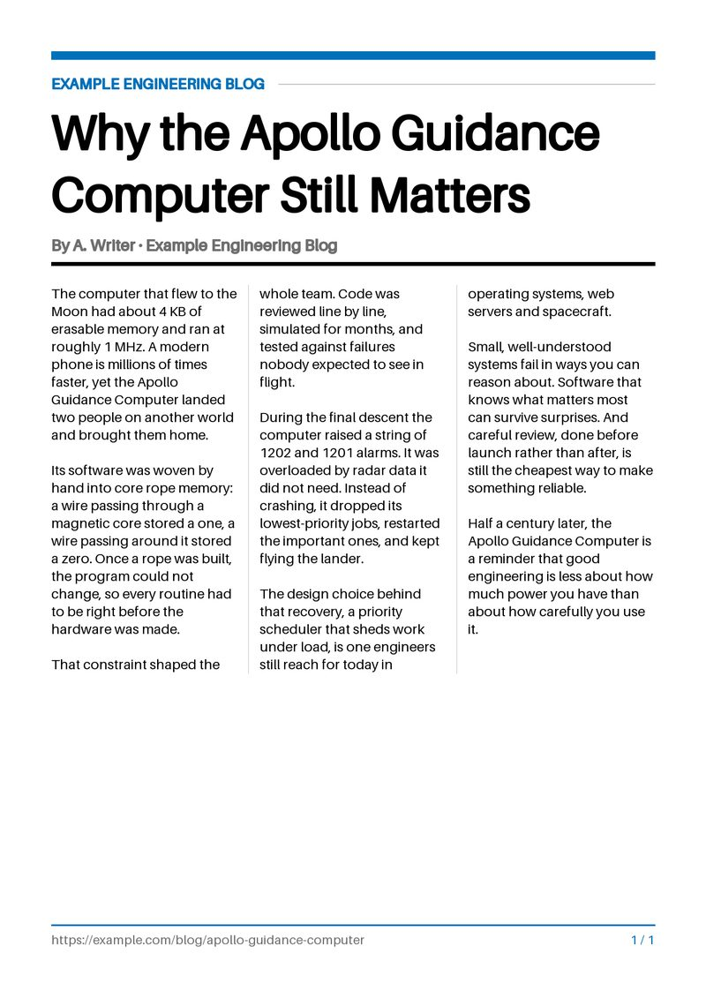

<p align="center"><picture><source media="(prefers-color-scheme: dark)" srcset="https://raw.githubusercontent.com/luongnv89/printer-cli/main/assets/logo/logo-white.svg"></picture></p>

<p align="center"><a href="https://pypi.org/project/printer-cli/"></a>  <a href="https://github.com/luongnv89/printer-cli/blob/main/LICENSE"></a></p>

Check ink, paper and alerts, run nozzle checks and head cleaning, print and scan on network printers, and print photos and web articles as newspaper and magazine pages, from a scriptable CLI or a full-screen TUI.

## Install

```bash
uv tool install printer-cli
```

Requires Python 3.11+. Puts `prt` on your PATH (`printer-cli` works too). Other methods: [Install options](#install-options).

## Quick start

Check a printer's ink, paper and alerts. No printer handy? The built-in `demo` printer replays a real Epson XP-6000:

```bash
prt -p demo status
```

```
╭─┐EPSON XP-6000 Series · office┌──────────────────────────────────────────╮
│ ● idle    firmware 20.50.NU30Q6 · up 4h02m                               │
├──────────────────────────────────────────────────────────────────────────┤
│ ink                                                                      │
│ Photo Black  ■■■■■■■■■■■■■■■■■■■■■■■■■■■■■■■■■■■■····  92%               │
│ Cyan         ········································   1%  ✗ replace    │
│ Magenta      ········································   1%  ✗ replace    │
│ Yellow       ■■■■····································  12%  ▲ low        │
│ Black        ■■■■■■■■■■■■■■■■■■■■■■■■■■■■■■■■■■■·····  89%               │
├──────────────────────────────────────────────────────────────────────────┤
│ paper   main A4 ✓   photo 4×6 ✓   disc Disc ✓   (levels not reported)    │
│ waste   ▲ almost full — service soon                                     │
╰─┘4 alerts · checked 17:42└───────────────────────────────────────────────╯
```

Next: [Use your own printer](#use-your-own-printer) · [Commands](#commands) · [The TUI](#the-tui) · [Photo booth](#photo-booth) · [Article printing](#article-printing) · [Vintage gazette](#vintage-gazette) · [Safety](#safety)

## Why printer-cli

It started because the Epson XP-6000's web dashboard stopped working. printer-cli talks to the printer directly over standard protocols (IPP, eSCL, SNMP, plus Epson's ESC/P2 remote mode for maintenance). It works with most AirPrint/Mopria printers from any brand, and you can manage several printers from one place.

## Use your own printer

```bash
prt discover                                        # find printers on the LAN and save new ones
prt printers default xp-6000                        # pick the default when several were saved
prt status                                          # ink, paper, alerts
prt tui                                             # full-screen dashboard
```

Every command also works against the built-in replay: `prt -p demo status`, `prt -p demo tui`.

Printers that `discover` can't see (another subnet, mDNS blocked) can be added by hand. `prt list` then shows which saved printers answer (here `office` points at the demo printer):

```bash
prt discover --wait 5                               # listen longer on a busy network
prt printers add pantum 192.168.1.80 --driver ipp   # save a printer by host or IP
prt printers remove pantum
prt list
```

```
╭─┐printers┌───────────────────────────────────────────────────────────────────╮
│    name    host          driver  state                                       │
│ ●  office  demo          fake    ● online                                    │
│    pantum  192.168.1.80  ipp     ○ offline                                   │
╰─┘2 saved · ● default└────────────────────────────────────────────────────────╯
```

## Status

| | Verified against the real XP-6000 | Covered by tests (replay of its data) |
|---|---|---|
| Ink, state, alerts, paper, firmware (IPP) | ✅ read live during development | ✅ |
| Page counter (SNMP) | ✅ | ✅ |
| Scanner capabilities (eSCL) | ✅ | ✅ |
| Scanning a page | ⏳ not yet | ✅ (mocked HTTP) |
| Printing (IPP / CUPS) | ⏳ not yet | ✅ (fake transport) |
| Nozzle check / head cleaning (ESC/P2 on 9100) | ⏳ not yet: bytes match gutenprint `escputil`, port 9100 is open | ✅ (byte-exact) |

## Commands

| Command | What it does |
|---|---|
| `prt status [--watch N]` | State, alerts, ink, paper, waste pad. `--watch` prints one line per sample |
| `prt ink` | Ink levels only |
| `prt overview` | System, software and hardware: model, serial, firmware, uptime, page count, formats, media, scanner, capabilities |
| `prt discover` | mDNS scan for printers and scanners. Saves each new printer under a short name; printers already saved and the default are left as they are |
| `prt list [--no-check]` | Saved printers and whether each one is online or offline (same as `prt printers list`) |
| `prt printers list/add/remove/default` | Manage saved printers. `list` checks each printer's connection and shows it as online or offline; `--no-check` skips the check |
| `prt maintain nozzle-check` | Print the nozzle check pattern |
| `prt maintain clean [--force]` | Head cleaning, with a safety check first (see [Safety](#safety)) |
| `prt maintain test-page` | Colour test page: ink bars, gradients, grey steps, fine lines |
| `prt maintain identify` | Flash the printer's panel |
| `prt print FILE… [-n 2] [--media 4x6] [--tray photo] [--quality high] [--mono] [--duplex] [--direct] [--wait] [--yes]` | Print; `--wait` returns once each job has finished and reports how it ended; `--yes` is needed in agent mode |
| `prt booth PHOTO [--style metro\|daily\|wizard\|wanted] [--story-file story.json] [--preview page.jpg] [--save page.pdf]` | Photo booth: print the photo as an A4 newspaper front page, wizard card or wanted poster (see [Photo booth](#photo-booth)) |
| `prt article URL\|FILE [--style magazine\|classic-magazine] [--preview page.pdf] [--save page.pdf]` | Print a blog post, news article or X post as A4 magazine pages (see [Article printing](#article-printing)) |
| `prt gazette PHOTO… [--landscape] [--story-file story.json] [--preview page.pdf] [--save page.pdf]` | Print one or more photos as a vintage newspaper, over as many A4 pages as the photos need (see [Vintage gazette](#vintage-gazette)) |
| `prt styles` | Every booth, article and gazette style and the options that pick it; with `-f json`, also each style's fields, character limits, photo count and a sample image (see [Styles and schemas](#styles-and-schemas)) |
| `prt schema story\|article\|gazette` | The JSON Schema of a booth story file, an article JSON file or a gazette story file |
| `prt jobs [--all]` / `prt jobs wait ID` / `prt jobs cancel ID` | List jobs, wait for one to finish, or cancel one |
| `prt scan [-o file.pdf] [--type jpeg] [--dpi 600] [--mode gray] [--area full]` | Flatbed scan (`-o -` writes to stdout) |
| `prt tui` | Full-screen dashboard |

**Global options**, which can go before or after the command:
- `-p/--printer NAME|HOST` picks the printer.
- `-f/--format json` prints machine-readable output, and errors as a JSON object (see [Scripting](#scripting)).
- `--no-color` turns colour off.
- `-q` hides notes and prints only results.
- `--timeout S` sets the network timeout in seconds.
- `--config PATH` uses a different config file.

### Examples

The outputs below come from the built-in `demo` printer.

**Ink levels**: `prt ink`

```
╭─┐ink · demo┌─────────────────────────────────────────────────────────────────╮
│ Photo Black  ■■■■■■■■■■■■■■■■■■■■■■■■■■■■■■■■■■■■····  92%                   │
│ Cyan         ········································   1%  ✗ replace        │
│ Magenta      ········································   1%  ✗ replace        │
│ Yellow       ■■■■····································  12%  ▲ low            │
│ Black        ■■■■■■■■■■■■■■■■■■■■■■■■■■■■■■■■■■■·····  89%                   │
╰─┘15:39└──────────────────────────────────────────────────────────────────────╯
```

**Watch status**: `prt status --watch 2` prints one line per sample until Ctrl-C.

```
15:39:31  ● idle       PB  92 C   1 M   1 Y  12 BK  89   4 alerts
15:39:33  ● idle       PB  92 C   1 M   1 Y  12 BK  89   4 alerts
15:39:35  ● idle       PB  92 C   1 M   1 Y  12 BK  89   4 alerts
```

**Overview**: `prt overview` (trimmed; it goes on with network, scanner and capabilities)

```
╭─┐EPSON XP-6000 Series · demo┌────────────────────────────────────────────────╮
│ system                                                                       │
│   model          EPSON XP-6000 Series                                        │
│   vendor         Epson                                                       │
│   serial         X00000000                                                   │
│   uuid           00000000-0000-4000-8000-000000000000                        │
│   driver         fake                                                        │
├──────────────────────────────────────────────────────────────────────────────┤
│ software                                                                     │
│   firmware       20.50.NU30Q6                                                │
│   ipp            1.0, 1.1, 2.0                                               │
│   formats        octet-stream, pwg-raster, urf, jpeg                         │
│   admin page     http://printer.local:80/PRESENTATION/BONJOUR                │
├──────────────────────────────────────────────────────────────────────────────┤
│ hardware                                                                     │
│   uptime         4h02m                                                       │
│   pages printed  1,538                                                       │
│   colour         yes                                                         │
│   duplex         yes                                                         │
│   speed          9 ppm                                                       │
│   resolutions    360dpi, 720dpi, 5760x1440dpi                                │
│   trays          main, photo, disc                                           │
│   media          A4, 4×6, 5×7, 8×10, A5, A6, Letter, Legal, L (3.5×5), B5 …  │
…
```

**Maintenance**

```bash
prt maintain nozzle-check     # print the pattern; a gap in a line means clogged nozzles
prt maintain clean            # head cleaning, refused while ink is low or the waste pad is near full
prt maintain test-page --yes  # colour test page, no prompt
prt maintain identify         # flash the panel to find the printer
```

**Printing**

```bash
prt print boarding-pass.pdf                                    # PDF goes through the local CUPS queue
prt print holiday.jpg --media 4x6 --tray photo --quality high  # photo paper from the photo tray
prt print notes.pdf -n 2 --duplex --mono                       # two double-sided black-and-white copies
prt print poster.png --direct                                  # straight to the printer, never via CUPS
```

**Jobs**: `prt jobs --all` includes finished jobs; cancel one by its id with `prt jobs cancel 42`.

**Waiting for a print**: `prt print photo.jpg --wait` returns only once the job has reached a final state (completed, canceled or aborted), and `prt jobs wait 42` does the same for a job already sent. A job that completed exits `0`; one that was cancelled or aborted is reported as such and exits `1`. `--wait-timeout SECONDS` (default 600) sets how long to wait for each job before giving up. With `-f json` each `prt print` result gains a `state`, and `prt jobs wait` prints the job. `--wait` follows only jobs sent to the printer directly (JPEG, PNG and other images): a PDF or other file that goes through CUPS is refused with exit code `2` before anything is sent.

```
╭─┐jobs · demo┌────────────────────────────────────────────────────────────────╮
│ id  name               state        user  pages                              │
│ 41  boarding-pass.pdf  ● completed  alex      1                              │
│ 42  nozzle-check       ● completed  prt       1                              │
╰─┘2 jobs└─────────────────────────────────────────────────────────────────────╯
```

**Scanning**

```bash
prt scan -o receipt.pdf                                  # A4, colour, 300 dpi PDF
prt scan -o photo.jpg --type jpeg --dpi 600 --area full  # whole glass as a JPEG
prt scan --mode gray -o letter.pdf                       # greyscale
```

### Scripting

```bash
prt ink -f json | jq -r '.inks[] | select(.state != "ok") | "\(.name): \(.level)%"'
prt status | grep '^alert'            # piped output is tab-separated, no colour
prt scan -o - --type jpeg > page.jpg
prt booth me.jpg --style daily --story-file story.json --preview page.jpg   # render only, nothing printed
prt article https://example.com/blog/post -o article.pdf                   # every page in one PDF, nothing printed
```

Exit codes: `0` ok · `1` runtime/network error (also when only cached status is shown, or a waited-for job did not print) · `2` usage error · `3` bad input file, an article that cannot be fetched or converted, or more photos than the gazette takes · `130` Ctrl-C.

**Errors as JSON**: with `-f json`, a failing command writes one JSON object as the last line of stderr instead of the `error:`/`hint:` text, so a script or agent can branch on the kind of error. `code` is the process exit code, and `hint` may be `null`:

```bash
$ prt -f json article https://example.com/gone
{"error": {"code": 3, "kind": "fetch_failed", "message": "cannot fetch https://example.com/gone: the site answered HTTP 404 Not Found", "hint": "..."}}
```

| kind | exit code | meaning |
|---|---|---|
| `unreachable` | 1 | the printer does not answer |
| `unsupported` | 1 | the printer cannot do this (see `prt overview`) |
| `rejected` | 1 | the printer refused the request |
| `refused` | 1 | a safety check stopped a maintenance task |
| `stale` | 1 | the printer is not answering; the output is its last known status |
| `declined` | 1 | the confirmation prompt was answered no |
| `job_failed` / `job_canceled` | 1 | a waited-for job was aborted or cancelled |
| `job_not_found` / `timeout` | 1 | a waited-for job is unknown, or still not finished after `--wait-timeout` |
| `error` | 1 | any other runtime failure |
| `usage` | 2 | bad command line, option value or argument |
| `confirmation_required` | 2 | a prompt is needed but there is no terminal: add `--yes` |
| `agent_confirmation_required` | 2 | agent mode (`PRT_AGENT=1`) and no `--yes`: nothing was sent |
| `page_cap_exceeded` | 1 | the print uses more pages than `max_pages_per_run` allows: nothing was sent |
| `daily_page_cap_exceeded` | 1 | the print would go over `max_pages_per_day`: nothing was sent |
| `page_count_unknown` | 1 | a page cap is in force and the file's pages cannot be counted (text, PWG, office files) |
| `page_ledger_unavailable` | 1 | `max_pages_per_day` is set but the page count cannot be recorded in the cache folder |
| `fetch_failed` | 3 | an article link could not be fetched |
| `invalid_input` | 3 | a bad input file or link |
| `interrupted` | 130 | Ctrl-C |

Without `-f json` error output is unchanged.

### Styles and schemas

An agent or script can find out what can be printed without reading this README. `prt styles -f json` lists every style as a JSON array; each entry has the command and the `args` that pick it, what it prints, its `fields` (with `required` and `max_length` in characters), how many `photos` it takes, `max_pages`, the name of its input `schema` and a link to a `sample` page:

```bash
$ prt styles -f json | jq -c '.[] | {name, command, args, schema}'
{"name":"metro","command":"booth","args":[],"schema":"story"}
{"name":"daily","command":"booth","args":["--style","daily"],"schema":"story"}
...
{"name":"gazette-landscape","command":"gazette","args":["--landscape"],"schema":"gazette"}
```

`prt schema story`, `prt schema article` and `prt schema gazette` print the JSON Schema (draft 2020-12) of the file `prt booth --story-file`, `prt article FILE.json` and `prt gazette --story-file` read. A file that passes the schema is accepted by the command; the one thing the schema cannot check is the character set, so text in a script the page font cannot print (emoji, Chinese) is still refused. In Python the same data is in `prt.catalog` (`styles()`, `schema(name)`, and `register_schema` to add one).

## The TUI

`prt tui` opens a keyboard-driven dashboard. Inks are drawn as vertical tanks in their real cartridge colours, alongside system info, paper and alerts. Tabs: **Dashboard · Maintain · Print · Scan · Jobs**.

<p align="center"></p>

| Key | Action |
|---|---|
| `r` | Refresh (auto-refreshes every 10 s) |
| `n` / `c` / `i` | Nozzle check / head cleaning (both ask first) / identify |
| `p` / `s` / `j` | Print, Scan, Jobs tabs |
| `1`–`9` | Switch between saved printers |
| `q` | Quit |

## Photo booth

`prt booth photo.jpg` prints the photo as a newspaper front page with a short news story, or as a themed card or poster. With no story each style uses its own built-in text.

```bash
prt booth astronaut.jpg --story-file story.json --preview metro.jpg         # metro, the default
prt booth astronaut.jpg --style daily --story-file story.json -o daily.jpg  # -o is short for --preview
prt booth astronaut.jpg --style wizard -o wizard.jpg                        # built-in story
prt booth astronaut.jpg --style wanted --headline "Captain Moonboots" --yes # print it, no prompt
```

<table><tr><td align="center"><br><code>metro</code></td><td align="center"><br><code>daily</code></td><td align="center"><br><code>wizard</code></td><td align="center"><br><code>wanted</code></td></tr></table>

The `metro` and `daily` samples use [story.json](https://github.com/luongnv89/printer-cli/blob/main/assets/samples/story.json); `wizard` and `wanted` use their built-in text.

- `--style metro` (default) is a colour tabloid with two columns. `--style daily` is a black-and-white broadsheet with three columns.
- `--style wizard` is an ornate trading card: a dark card with a gold double border and cut marks, the photo in an arched gold frame, a moon-and-star emblem, a name ribbon and a lore box. `--style wanted` is a weathered parchment poster: huge WANTED lettering, the photo in a heavy frame, a "dead or alive" line, the name and a reward.
- The themed styles reuse the story fields: `headline` is the name, `kicker` the card type (wizard) or the "dead or alive" line (wanted), `caption` the subtitle (wizard) or the reward line (wanted), `story` the lore or description, and `byline` the footer. Without them, `wanted` prints "The Grinning Captain" with a reward of 1,000,000 gold.
- Write your own story as JSON: `headline` and `story` are required, `kicker`, `caption` and `byline` are optional. Pass it with `--story-file story.json`, or pipe it in with `--story-file -` to read it from stdin, so no file has to be written. `--headline`, `--story`, `--kicker`, `--caption` and `--byline` override single fields.
- The page uses the font that ships with Pillow, which covers basic Latin only. Accents print without their marks, and other scripts and emoji are refused with an error.
- `--preview page.jpg` saves the page without printing. The file name picks the type: `.jpg`/`.jpeg` (JPEG), `.png` (lossless image) or `.pdf` (one A4 page); any other name is refused.
- `--save page.pdf` keeps a digital copy and still prints the page. Repeat it for more files, e.g. `--save page.pdf --save page.png`. Copies are written before the printer is contacted, so they are kept even if printing is declined or the printer is asleep.
- The length limits (headline 120, story 2500, kicker 40, caption 200, byline 80 characters) are what the command accepts, not what always fits. `metro` has the least room: about 70 characters of headline on two full-size lines, about 100 on three smaller ones, and about 100 characters of caption under a portrait photo.
- Text too long for its space is cut with `…` after the last whole word that fits, and `prt booth` warns on stderr naming the fields that were cut. With `-f json` the output says the same in a fit report: `"fits": false` and, for each cut field in page order, how many of its characters were printed and how many were given, e.g. `"cut": {"headline": {"max_fit": 68, "given": 92}}`. Shortening the field to `max_fit` characters makes it fit, so a script or agent can cut the text and try again. When everything fits the report is `"fits": true, "cut": {}`. Transparent parts of a PNG print as white paper.
- The photo and story are checked before anything is sent, so an unreadable image or a bad story file exits with an error and prints nothing.

To let an AI agent look at the photo and write a story that fits it, give it the [photo-booth skill](https://github.com/luongnv89/printer-cli/blob/main/skills/photo-booth/SKILL.md).

## Article printing

`prt article https://example.com/blog/post` prints a web article as A4 magazine pages. It keeps the title, author, site name and the full text, and leaves out navigation, ads, share bars, comments and other page clutter.

```bash
prt article https://example.com/blog/post                          # fetch, confirm, print
prt article article.json --preview article.png                     # one PNG per page, nothing printed
prt article article.json --style classic-magazine -o article.pdf   # every page in one PDF
prt article https://x.com/user/status/1234567890 --yes             # one public X post
prt article - --yes < article.json                                 # the article on stdin
```

<table><tr><td align="center"><br><code>magazine</code></td><td align="center"><br><code>classic-magazine</code></td></tr></table>

Both samples are page 1 of [article.json](https://github.com/luongnv89/printer-cli/blob/main/assets/samples/article.json).

- `--style magazine` (default) is a white page with a blue accent bar and section label, a big bold headline and three ruled columns. `--style classic-magazine` is an ivory page in a double-rule frame with a centred headline between fleurons, one centred column and a drop cap.
- Long articles run on over as many pages as they need, up to 30; nothing is cut. Each page is printed as its own job, after one confirmation prompt (`--yes` skips it).
- Links must start with `http://` or `https://`. Pages are fetched with certificate checks, at most 5 redirects and 5 MiB, within the `--timeout` (default 5 s).
- X posts (`https://x.com/<user>/status/<id>`, also `twitter.com`) are read through X's public oEmbed service, which returns the text of one public post only: no images, no threads, nothing behind a login.
- For pages the command cannot read (a login wall, text built by JavaScript, a long X thread), pass a saved file instead: article JSON (`{"title": "...", "author": "...", "source": "...", "url": "...", "body": ["paragraph", "..."]}`), a saved `.html` page, or a text file whose first line is the title. `prt article -` reads the same from stdin: JSON when the input starts with `{`, HTML when it starts with `<`, else plain text, up to 5 MiB. The [article-print skill](https://github.com/luongnv89/printer-cli/blob/main/skills/article-print/SKILL.md) lets an AI agent fetch the article itself and write that JSON.
- `--preview page.pdf` saves the pages without printing: a `.pdf` holds every page, while `.png`, `.jpg` or `.jpeg` save one image per page (`page-1.png`, `page-2.png`, …). `--save` keeps the same copies and still prints.
- The page font covers Latin letters only: accents print without their marks, emoji are left out, and an article mostly in another script is refused.
- When the article cannot be fetched or converted, `prt article` exits with code 3 and a hint, and nothing is sent to the printer.

## Vintage gazette

`prt gazette photo.jpg` prints a photo as the front page of an old newspaper, after the look of [luongnv.com/news](https://luongnv.com/news): cream paper and one dark ink, a blackletter masthead between double rules, a small-caps dateline, a headline in capitals, the photo toned from ink to paper, and a short story in two ruled columns. With no story it prints its own.

```bash
prt gazette me.jpg --headline "Local Star Steps Out" --preview page.pdf   # one photo, one page, nothing printed
prt gazette trip-1.jpg trip-2.jpg trip-3.jpg trip-4.jpg --save trip.pdf   # four photos on two pages, printed
prt gazette a.jpg b.jpg c.jpg --landscape -o page.pdf                     # A4 on its side, nothing printed
```

<table><tr><td align="center"><br><code>portrait</code></td><td align="center"><br><code>--landscape</code></td></tr></table>

Both samples: `prt gazette astronaut.jpg launch.jpg earthrise.jpg --story-file story.json -o gazette.png`, the second with `--landscape`.

- Give several photos to print them all. The first is the lead picture, and the front page also holds the next two as plates. Each further page holds up to six more in a ruled grid, numbered Fig. 4, Fig. 5 and so on. No photo is left out: 4 photos make 2 pages, 10 make 3.
- `--landscape` lays the pages out on A4 turned on its side: the lead photo stands beside the story, the two plates sit under the story, and further pages hold their six plates three abreast. Saved pages stay landscape; each page is turned upright only for the printer, so it prints sideways on the sheet.
- One run takes at most 57 photos (10 pages). More are refused with exit code 3 before any photo is read, written or printed, so print them in batches.
- The story works as in `prt booth`: `--story-file story.json`, or `--story-file -` for stdin (`headline` and `story` required; `kicker`, `caption` and `byline` optional), with `--headline`, `--story`, `--kicker`, `--caption` and `--byline` to override single fields. The caption goes under the lead photo. A story too long for the front page is set in smaller type, then cut with `…`, and the command warns. With `-f json` the output carries the same fit report as `prt booth` (`fits`, and `cut` with `max_fit` and `given` for each cut field).
- `--preview`/`-o` and `--save` work as in `prt article`: a `.pdf` holds every page, while `.png`, `.jpg` or `.jpeg` save one image per page (`page-1.png`, `page-2.png`, …). A file name that would overwrite one of the photos is refused with exit code 2.
- Every photo is read before anything is written or sent, so an unreadable or unsupported photo exits with code 3, names the file and prints nothing. Each page prints as its own job after one confirmation (`--yes` skips it). If a later page fails, the jobs already queued are named so you can cancel them with `prt jobs cancel`.
- The type is UnifrakturMaguntia, Playfair Display and Old Standard TT, which ship with printer-cli (see [License](#license)). Letters these fonts lack print without their accents, and other scripts and emoji are refused as in the photo booth.

## Safety

- **Head cleaning is refused** while any ink is at or below its low level, or while the waste ink pad is flagged. Cleaning flushes ink into the pad, and a full pad locks the printer until it's serviced. `--force` overrides this, and the TUI offers "Clean anyway".
- Nozzle check, cleaning, the test page, the photo booth, article printing and the gazette ask for confirmation first. In scripts, pass `--yes`.
- printer-cli never resets the waste ink counter or writes to the printer's EEPROM.

### Agent guardrails

Before you let an AI agent print unattended, set `PRT_AGENT=1` in its environment and, if you like, page caps in the config file:

- **Agent mode** (`PRT_AGENT=1`, also `true`, `yes` or `on`): every command that prints or uses ink — `print`, `booth`, `article`, `gazette`, `maintain test-page`, `maintain nozzle-check`, `maintain clean` — refuses to run without `--yes`, even at a terminal, so an agent never sits waiting on a prompt and never prints without deciding to. The refusal exits `2` with kind `agent_confirmation_required`. `--preview` needs no `--yes`: it prints nothing.
- **Per-run cap**: `max_pages_per_run` in the config limits the pages one command may print (copies count). In agent mode it defaults to 10 when not set.
- **Daily cap**: `max_pages_per_day` in the config limits the pages printed per calendar day, counted across every command in `~/.cache/prt/pages.json`. A page counts once its job has been sent, even if sending failed, because the printer may have taken it.
- A print over a cap is refused whole, before the prompt and before anything is sent (exit `1`, kind `page_cap_exceeded` or `daily_page_cap_exceeded`). Configured caps apply outside agent mode too, and in the TUI. While a cap is in force, a file whose pages cannot be counted (plain text, PWG raster, office files) is refused with `page_count_unknown`; images count as one page and PDF pages are counted from the file.
- **Cost estimate**: with `-f json`, `prt booth`, `prt article` and `prt gazette` (preview or print) add an `estimate` of the rendered pages: the page count, whether they use colour, and for each ink the share of a standard cartridge they would use, e.g. `"estimate": {"pages": 3, "colour": true, "ink": {"cyan": 1.2, "magenta": 1.0, "yellow": 1.1, "black": 3.8}, "ink_percent": 3.8, "summary": "~3 pages, colour, est. ink 4%"}`. `ink_percent` is the cartridge that would run out first. The ink figures are rough: they assume a cartridge prints about 300 pages at 5% coverage.

These guardrails stop a cooperating agent from using up a cartridge by mistake. They are not a security boundary: a process that can change its own environment or config can get around them.

With the demo printer's low inks and nearly full pad, `prt -p demo maintain clean` refuses and exits with code 1:

```
✗ Cyan ink is at 1% (low level 15%) — cleaning may empty it; replace the cartridge first
✗ Magenta ink is at 1% (low level 15%) — cleaning may empty it; replace the cartridge first
✗ Yellow ink is at 12% (low level 15%) — cleaning may empty it; replace the cartridge first
✗ waste ink pad is almost full — each cleaning adds to it; the printer may lock up when it is full
✗ error: head cleaning refused for safety
hint: replace low cartridges first, or pass --force if you understand the risk
```

## How it talks to printers

| Feature | Protocol | Notes |
|---|---|---|
| Status, ink, info, jobs, identify | IPP (631) | Small IPP codec built in, no `ipptool` needed |
| Printing | IPP Print-Job | JPEG/PWG/URF go direct; PNG etc. are converted to JPEG; **PDF and other files go through the local CUPS queue** for the same printer, matched by UUID (the XP-6000 doesn't accept PDF) |
| Scanning | eSCL / AirScan (443) | Certificate checks are skipped for the scanner host only, because printers ship self-signed certificates |
| Page counter | SNMP v1 | Printer-MIB lifetime count |
| Nozzle check, cleaning | ESC/P2 remote mode on 9100 | Byte sequences from gutenprint's `escputil` (Epson only) |

When the printer is asleep, `status` and the TUI show the **last known status** from `~/.cache/prt/`, marked as cached.

## Configuration

`~/.config/prt/config.toml`. Override the location with `PRT_CONFIG` or `--config`. Priority order: **command-line flags > environment variables (`PRT_PRINTER`, `PRT_TIMEOUT`) > config file > defaults**.

```toml
default = "office"

[printers.office]
host = "EPSON721655.local"

[printers.pantum]
host = "192.168.1.80"
driver = "ipp"
```

`max_pages_per_run = 20` and `max_pages_per_day = 50`, at the top of the file, cap how many pages a print may use (see [Agent guardrails](#agent-guardrails)). Each must be a whole number of 1 or more; leave it out for no limit. `PRT_AGENT=1` turns on agent mode.

## Install options

With pipx:

```bash
pipx install printer-cli
```

From source (add `--editable` to track local changes):

```bash
git clone https://github.com/luongnv89/printer-cli.git && cd printer-cli
uv tool install .
```

Optional tab completion for your shell:

```bash
prt --install-completion
```

## Adding a printer brand

Drivers live in `src/prt/drivers/`:
- `IPPDriver` covers any IPP Everywhere / AirPrint printer.
- `EpsonDriver` adds maintenance and counters on top of it.
- `FakeDriver` replays a captured fixture, for tests and the demo.

To add a vendor, subclass `IPPDriver`, declare its `capabilities`, override what it can do, and register it in `drivers/registry.py`. The CLI and TUI hide actions a driver doesn't support.

## Development

```bash
uv sync
uv run pytest            # 559 tests, no printer needed
uv run prt -p demo tui
```

## Troubleshooting

- **"cannot reach printer"**: the printer is probably asleep. Press any button on it, or check `prt discover`.
- **Shell completion isn't detected**: write the script out manually, e.g. `_PRT_COMPLETE=source_zsh prt > ~/.zfunc/_prt`.
- **PDF won't print**: add the printer in System Settings → Printers so a CUPS queue exists, or print a JPEG.

## License

[MIT](https://github.com/luongnv89/printer-cli/blob/main/LICENSE) © Luong NGUYEN

The fonts used by `prt gazette`, [UnifrakturMaguntia](https://github.com/google/fonts/tree/main/ofl/unifrakturmaguntia), [Playfair Display](https://github.com/google/fonts/tree/main/ofl/playfairdisplay) and [Old Standard TT](https://github.com/google/fonts/tree/main/ofl/oldstandardtt), are under the SIL Open Font License 1.1. Their licence texts ship with them in [`src/prt/fonts`](https://github.com/luongnv89/printer-cli/tree/main/src/prt/fonts) as `OFL-*.txt`.

The photos in the sample pages ([`assets/samples`](https://github.com/luongnv89/printer-cli/tree/main/assets/samples)) are public-domain NASA images from Apollo 8 and Apollo 11, via Wikimedia Commons.
