<p align="center"><picture><source media="(prefers-color-scheme: dark)" srcset="https://raw.githubusercontent.com/luongnv89/printer-cli/main/assets/logo/logo-readme-dark.svg"></picture></p>

<p align="center"><a href="https://pypi.org/project/printer-cli/"></a>  <a href="https://github.com/luongnv89/printer-cli/blob/main/LICENSE"></a></p>

Check ink, paper and alerts, run nozzle checks and head cleaning, print and scan on network printers, and print photos and web articles as newspaper and magazine pages, from a scriptable CLI or a full-screen TUI.

## Install

```bash
uv tool install printer-cli
```

Requires Python 3.11+. Puts `prt` on your PATH (`printer-cli` works too). Other methods: [Install options](#install-options).

## Quick start

Check a printer's ink, paper and alerts. No printer handy? The built-in `demo` printer replays a real Epson XP-6000:

```bash
prt -p demo status
```

```
╭─┐EPSON XP-6000 Series · office┌──────────────────────────────────────────╮
│ ● idle    firmware 20.50.NU30Q6 · up 4h02m                               │
├──────────────────────────────────────────────────────────────────────────┤
│ ink                                                                      │
│ Photo Black  ■■■■■■■■■■■■■■■■■■■■■■■■■■■■■■■■■■■■····  92%               │
│ Cyan         ········································   1%  ✗ replace    │
│ Magenta      ········································   1%  ✗ replace    │
│ Yellow       ■■■■····································  12%  ▲ low        │
│ Black        ■■■■■■■■■■■■■■■■■■■■■■■■■■■■■■■■■■■·····  89%               │
├──────────────────────────────────────────────────────────────────────────┤
│ paper   main A4 ✓   photo 4×6 ✓   disc Disc ✓   (levels not reported)    │
│ waste   ▲ almost full — service soon                                     │
╰─┘4 alerts · checked 17:42└───────────────────────────────────────────────╯
```

Next: [Use your own printer](#use-your-own-printer) · [Commands](#commands) · [The TUI](#the-tui) · [Photo booth](#photo-booth) · [Greeting card](#greeting-card) · [4×6 photo prints](#46-photo-prints) · [Colouring pages](#colouring-pages) · [Postcards](#postcards) · [Disc labels](#disc-labels) · [Recipe cards](#recipe-cards) · [Bingo cards](#bingo-cards) · [Puzzles](#puzzles) · [Article printing](#article-printing) · [Vintage gazette](#vintage-gazette) · [Safety](#safety)

## Why printer-cli

It started because the Epson XP-6000's web dashboard stopped working. printer-cli talks to the printer directly over standard protocols (IPP, eSCL, SNMP, plus Epson's ESC/P2 remote mode for maintenance). It works with most AirPrint/Mopria printers from any brand, and you can manage several printers from one place.

## Use your own printer

```bash
prt discover                                        # find printers on the LAN and save new ones
prt printers default xp-6000                        # pick the default when several were saved
prt status                                          # ink, paper, alerts
prt tui                                             # full-screen dashboard
```

Every command also works against the built-in replay: `prt -p demo status`, `prt -p demo tui`.

Printers that `discover` can't see (another subnet, mDNS blocked) can be added by hand. `prt list` then shows which saved printers answer (here `office` points at the demo printer):

```bash
prt discover --wait 5                               # listen longer on a busy network
prt printers add pantum 192.168.1.80 --driver ipp   # save a printer by host or IP
prt printers remove pantum
prt list
```

```
╭─┐printers┌───────────────────────────────────────────────────────────────────╮
│    name    host          driver  state                                       │
│ ●  office  demo          fake    ● online                                    │
│    pantum  192.168.1.80  ipp     ○ offline                                   │
╰─┘2 saved · ● default└────────────────────────────────────────────────────────╯
```

## Status

| | Verified against the real XP-6000 | Covered by tests (replay of its data) |
|---|---|---|
| Ink, state, alerts, paper, firmware (IPP) | ✅ read live during development | ✅ |
| Page counter (SNMP) | ✅ | ✅ |
| Scanner capabilities (eSCL) | ✅ | ✅ |
| Scanning a page | ⏳ not yet | ✅ (mocked HTTP) |
| Printing (IPP / CUPS) | ⏳ not yet | ✅ (fake transport) |
| Nozzle check / head cleaning (ESC/P2 on 9100) | ⏳ not yet: bytes match gutenprint `escputil`, port 9100 is open | ✅ (byte-exact) |

## Commands

| Command | What it does |
|---|---|
| `prt status [--watch N]` | State, alerts, ink, paper, waste pad. `--watch` prints one line per sample |
| `prt ink` | Ink levels only |
| `prt overview` | System, software and hardware: model, serial, firmware, uptime, page count, formats, media, scanner, capabilities |
| `prt discover` | mDNS scan for printers and scanners. Saves each new printer under a short name; printers already saved and the default are left as they are |
| `prt list [--no-check]` | Saved printers and whether each one is online or offline (same as `prt printers list`) |
| `prt printers list/add/remove/default` | Manage saved printers. `list` checks each printer's connection and shows it as online or offline; `--no-check` skips the check |
| `prt maintain nozzle-check` | Print the nozzle check pattern |
| `prt maintain clean [--force]` | Head cleaning, with a safety check first (see [Safety](#safety)) |
| `prt maintain test-page` | Colour test page: ink bars, gradients, grey steps, fine lines |
| `prt maintain identify` | Flash the printer's panel |
| `prt keepalive [--preview patch.png] [--yes]` | Keep-alive patch: a small square of every ink colour on one A4 sheet, to print every few days so the nozzles do not clog (see [Keep-alive patch](#keep-alive-patch)) |
| `prt print FILE… [-n 2] [--media 4x6] [--tray photo] [--quality high] [--mono] [--duplex] [--direct] [--wait] [--yes]` | Print; `--wait` returns once each job has finished and reports how it ended; `--yes` is needed in agent mode |
| `prt booth PHOTO [--style metro\|daily\|wizard\|wanted\|certificate\|sports\|missing\|movie] [--story-file story.json] [--preview page.jpg] [--save page.pdf]` | Photo booth: print the photo as an A4 newspaper front page, wizard or sports card, certificate, or wanted, missing-pet or movie poster (see [Photo booth](#photo-booth)) |
| `prt card PHOTO [--card-file card.json] [--greeting TEXT] [--verse TEXT] [--preview card.pdf] [--save card.pdf]` | Print a greeting card: the photo and a verse on one A4 sheet that folds into an A6 card (see [Greeting card](#greeting-card)) |
| `prt comic PHOTO… [--comic-file comic.json] [--title TEXT] [--preview comic.png] [--save comic.pdf]` | Print 3 to 6 photos as the panels of an A4 comic page, with speech bubbles, thought bubbles and captions from a JSON comic file (see [Comic strips](#comic-strips)) |
| `prt strip PHOTO PHOTO PHOTO PHOTO [--caption TEXT] [--mono] [--preview strip.jpg] [--save strip.pdf]` | Print a four-frame photo-booth strip on 4×6 photo paper from the photo tray, twice side by side to cut into two strips (see [4×6 photo prints](#46-photo-prints)) |
| `prt instant PHOTO [--caption TEXT] [--preview photo.jpg] [--save photo.pdf]` | Print a photo as a Polaroid-style instant photo with a handwritten caption on 4×6 photo paper (see [4×6 photo prints](#46-photo-prints)) |
| `prt colour-in PHOTO [--preview page.png] [--save page.pdf]` | Print a photo as a colouring page: black line art on white, on A4 (see [Colouring pages](#colouring-pages)) |
| `prt postcard PHOTO [--postcard-file postcard.json] [--message TEXT] [--address LINE]… [--side front\|back] [--duplex] [--preview card.pdf] [--save card.pdf]` | Print a two-sided postcard on 4×6 photo paper: the photo on the front, the message, address lines and a stamp box on the back (see [Postcards](#postcards)) |
| `prt disc PHOTO [--disc-file disc.json] [--title TEXT] [--track TEXT]… [--preview disc.png] [--save disc.pdf]` | Print a circular label on a printable CD/DVD through the disc tray: the photo, a title and a track list (see [Disc labels](#disc-labels)) |
| `prt recipe URL\|FILE [--preview card.pdf] [--save card.pdf]` | Print a recipe as 4×6 index cards from the photo tray (see [Recipe cards](#recipe-cards)) |
| `prt bingo [--theme "road trip"] [-n 8] [--words-file words.json] [--seed N] [--preview cards.pdf] [--save cards.pdf]` | Print bingo cards, a different one for each player, one per A4 page (see [Bingo cards](#bingo-cards)) |
| `prt puzzle sudoku\|wordsearch\|crossword\|maze [--difficulty easy\|medium\|hard] [--seed N] [--crossword-file crossword.json] [--answers answers.json] [--preview page.png] [--save page.pdf]` | Print a sudoku, word search, crossword or maze on A4, and keep its solution to check the filled-in sheet (see [Puzzles](#puzzles)) |
| `prt article URL\|FILE [--style magazine\|classic-magazine] [--preview page.pdf] [--save page.pdf]` | Print a blog post, news article or X post as A4 magazine pages (see [Article printing](#article-printing)) |
| `prt gazette PHOTO… [--landscape] [--story-file story.json] [--preview page.pdf] [--save page.pdf]` | Print one or more photos as a vintage newspaper, over as many A4 pages as the photos need (see [Vintage gazette](#vintage-gazette)) |
| `prt gazette --edition morning --edition-file morning.json [--preview page.pdf] [--save page.pdf]` | Print the text-first Morning Gazette: weather, calendar, to-dos and headlines on one A4 page (see [Morning edition](#morning-edition)) |
| `prt receipt [REPO] [--period day\|week] [--preview receipt.pdf] [--save receipt.pdf]` | Print the repository's day or week of git commits as a one-page commit receipt (see [Commit receipt](#commit-receipt)) |
| `prt compose PAGE.json [--preview page.pdf] [--save page.pdf]` | Print a page you describe as blocks: headings, text, images, QR codes, columns and rules (see [Compose a page](#compose-a-page)) |
| `prt styles` | Every booth, card, comic, strip, instant, colour-in, postcard, disc, article, recipe, bingo, puzzle and gazette style and the options that pick it; with `-f json`, also each style's fields, character limits, photo count and a sample image (see [Styles and schemas](#styles-and-schemas)) |
| `prt schema story\|article\|gazette\|morning\|page\|card\|comic\|recipe\|postcard\|disc\|bingo\|wordsearch\|crossword` | The JSON Schema of a booth story file, an article JSON file, a gazette story file, a morning-edition file, a `prt compose` page file, a `prt card` card file, a `prt comic` comic file, a `prt recipe` recipe file, a `prt postcard` postcard file, a `prt disc` label file, a `prt bingo` words file, a `prt puzzle wordsearch` words file or a `prt puzzle crossword` crossword file |
| `prt jobs [--all]` / `prt jobs wait ID` / `prt jobs cancel ID` | List jobs, wait for one to finish, or cancel one |
| `prt scan [-o file.pdf] [--type jpeg] [--dpi 600] [--mode gray] [--area full]` | Flatbed scan (`-o -` writes to stdout) |
| `prt tui` | Full-screen dashboard |
| `prt mcp` | Run prt as an MCP server over stdio for AI agents (needs `printer-cli[mcp]`; see [MCP server](#mcp-server)) |
| `prt skills list` / `prt skills install [--claude] [--agents] [--project] [--dir PATH] [--force]` | List the agent skills that come with prt, or install them for Claude Code or other agents (see [Agent skills](#agent-skills)) |

**Global options**, which can go before or after the command:
- `-p/--printer NAME|HOST` picks the printer.
- `-f/--format json` prints machine-readable output, and errors as a JSON object (see [Scripting](#scripting)).
- `--no-color` turns colour off.
- `-q` hides notes and prints only results.
- `--timeout S` sets the network timeout in seconds.
- `--config PATH` uses a different config file.

### Examples

The outputs below come from the built-in `demo` printer.

**Ink levels**: `prt ink`

```
╭─┐ink · demo┌─────────────────────────────────────────────────────────────────╮
│ Photo Black  ■■■■■■■■■■■■■■■■■■■■■■■■■■■■■■■■■■■■····  92%                   │
│ Cyan         ········································   1%  ✗ replace        │
│ Magenta      ········································   1%  ✗ replace        │
│ Yellow       ■■■■····································  12%  ▲ low            │
│ Black        ■■■■■■■■■■■■■■■■■■■■■■■■■■■■■■■■■■■·····  89%                   │
╰─┘15:39└──────────────────────────────────────────────────────────────────────╯
```

**Watch status**: `prt status --watch 2` prints one line per sample until Ctrl-C.

```
15:39:31  ● idle       PB  92 C   1 M   1 Y  12 BK  89   4 alerts
15:39:33  ● idle       PB  92 C   1 M   1 Y  12 BK  89   4 alerts
15:39:35  ● idle       PB  92 C   1 M   1 Y  12 BK  89   4 alerts
```

**Overview**: `prt overview` (trimmed; it goes on with network, scanner and capabilities)

```
╭─┐EPSON XP-6000 Series · demo┌────────────────────────────────────────────────╮
│ system                                                                       │
│   model          EPSON XP-6000 Series                                        │
│   vendor         Epson                                                       │
│   serial         X00000000                                                   │
│   uuid           00000000-0000-4000-8000-000000000000                        │
│   driver         fake                                                        │
├──────────────────────────────────────────────────────────────────────────────┤
│ software                                                                     │
│   firmware       20.50.NU30Q6                                                │
│   ipp            1.0, 1.1, 2.0                                               │
│   formats        octet-stream, pwg-raster, urf, jpeg                         │
│   admin page     http://printer.local:80/PRESENTATION/BONJOUR                │
├──────────────────────────────────────────────────────────────────────────────┤
│ hardware                                                                     │
│   uptime         4h02m                                                       │
│   pages printed  1,538                                                       │
│   colour         yes                                                         │
│   duplex         yes                                                         │
│   speed          9 ppm                                                       │
│   resolutions    360dpi, 720dpi, 5760x1440dpi                                │
│   trays          main, photo, disc                                           │
│   media          A4, 4×6, 5×7, 8×10, A5, A6, Letter, Legal, L (3.5×5), B5 …  │
…
```

**Maintenance**

```bash
prt maintain nozzle-check     # print the pattern; a gap in a line means clogged nozzles
prt maintain clean            # head cleaning, refused while ink is low or the waste pad is near full
prt maintain test-page --yes  # colour test page, no prompt
prt maintain identify         # flash the panel to find the printer
```

**Printing**

```bash
prt print boarding-pass.pdf                                    # PDF goes through the local CUPS queue
prt print holiday.jpg --media 4x6 --tray photo --quality high  # photo paper from the photo tray
prt print notes.pdf -n 2 --duplex --mono                       # two double-sided black-and-white copies
prt print poster.png --direct                                  # straight to the printer, never via CUPS
```

**Jobs**: `prt jobs --all` includes finished jobs; cancel one by its id with `prt jobs cancel 42`.

**Waiting for a print**: `prt print photo.jpg --wait` returns only once the job has reached a final state (completed, canceled or aborted), and `prt jobs wait 42` does the same for a job already sent. A job that completed exits `0`; one that was cancelled or aborted is reported as such and exits `1`. `--wait-timeout SECONDS` (default 600) sets how long to wait for each job before giving up. With `-f json` each `prt print` result gains a `state`, and `prt jobs wait` prints the job. `--wait` follows only jobs sent to the printer directly (JPEG, PNG and other images): a PDF or other file that goes through CUPS is refused with exit code `2` before anything is sent.

```
╭─┐jobs · demo┌────────────────────────────────────────────────────────────────╮
│ id  name               state        user  pages                              │
│ 41  boarding-pass.pdf  ● completed  alex      1                              │
│ 42  nozzle-check       ● completed  prt       1                              │
╰─┘2 jobs└─────────────────────────────────────────────────────────────────────╯
```

**Scanning**

```bash
prt scan -o receipt.pdf                                  # A4, colour, 300 dpi PDF
prt scan -o photo.jpg --type jpeg --dpi 600 --area full  # whole glass as a JPEG
prt scan --mode gray -o letter.pdf                       # greyscale
```

With `-p demo` the scanner answers too: a PDF scan is a blank page, and a JPEG scan is a sample handwritten letter, so the [letter gazette](#vintage-gazette) workflow can be tried without hardware.

### Scripting

```bash
prt ink -f json | jq -r '.inks[] | select(.state != "ok") | "\(.name): \(.level)%"'
prt status | grep '^alert'            # piped output is tab-separated, no colour
prt scan -o - --type jpeg > page.jpg
prt booth me.jpg --style daily --story-file story.json --preview page.jpg   # render only, nothing printed
prt article https://example.com/blog/post -o article.pdf                   # every page in one PDF, nothing printed
prt compose flyer.json --preview flyer.png                                 # a page of blocks, nothing printed
```

Exit codes: `0` ok · `1` runtime/network error (also when only cached status is shown, or a waited-for job did not print) · `2` usage error · `3` bad input file (including a page file that fails its schema or names an image that cannot be read), an article that cannot be fetched or converted, or more photos than the gazette takes · `130` Ctrl-C.

**Errors as JSON**: with `-f json`, a failing command writes one JSON object as the last line of stderr instead of the `error:`/`hint:` text, so a script or agent can branch on the kind of error. `code` is the process exit code, and `hint` may be `null`:

```bash
$ prt -f json article https://example.com/gone
{"error": {"code": 3, "kind": "fetch_failed", "message": "cannot fetch https://example.com/gone: the site answered HTTP 404 Not Found", "hint": "..."}}
```

| kind | exit code | meaning |
|---|---|---|
| `unreachable` | 1 | the printer does not answer |
| `unsupported` | 1 | the printer cannot do this (see `prt overview`) |
| `rejected` | 1 | the printer refused the request |
| `refused` | 1 | a safety check stopped a maintenance task |
| `stale` | 1 | the printer is not answering; the output is its last known status |
| `declined` | 1 | the confirmation prompt was answered no |
| `job_failed` / `job_canceled` | 1 | a waited-for job was aborted or cancelled |
| `job_not_found` / `timeout` | 1 | a waited-for job is unknown, or still not finished after `--wait-timeout` |
| `error` | 1 | any other runtime failure |
| `usage` | 2 | bad command line, option value or argument |
| `confirmation_required` | 2 | a prompt is needed but there is no terminal: add `--yes` |
| `agent_confirmation_required` | 2 | agent mode (`PRT_AGENT=1`) and no `--yes`: nothing was sent |
| `page_cap_exceeded` | 1 | the print uses more pages than `max_pages_per_run` allows: nothing was sent |
| `daily_page_cap_exceeded` | 1 | the print would go over `max_pages_per_day`: nothing was sent |
| `page_count_unknown` | 1 | a page cap is in force and the file's pages cannot be counted (text, PWG, office files) |
| `page_ledger_unavailable` | 1 | `max_pages_per_day` is set but the page count cannot be recorded in the cache folder |
| `manual_flip_required` | 2 | `prt postcard` would print both sides with the card turned over by hand, and there is no terminal to say when (or agent mode): print `--side front`, then `--side back`. Nothing was sent |
| `duplex_unavailable` | 1 | `prt postcard --duplex`: the printer does not report two-sided printing, or has no CUPS queue to send the two-sided job to. Nothing was sent |
| `unknown_theme` | 2 | `prt bingo --theme` or `prt puzzle wordsearch --theme` names no bundled theme and no `--words-file` gives the words: nothing was written or sent |
| `disc_tray_unavailable` | 1 | `prt disc`: the printer lists its trays and none of them is a disc tray. Nothing was sent (`--save` copies are still written) |
| `missing_dependency` | 2 | `prt mcp` was run without the MCP SDK: install `printer-cli[mcp]` |
| `skill_exists` | 1 | `prt skills install` found an installed skill file that differs from the bundled one: nothing was installed, `--force` replaces it |
| `skills_missing` | 1 | this prt install has no bundled skills: reinstall printer-cli |
| `fetch_failed` | 3 | an article or recipe link could not be fetched |
| `no_recipe` | 3 | `prt recipe` found no recipe on the page or in the file (no schema.org Recipe data, no Ingredients and Instructions headings) |
| `invalid_input` | 3 | a bad input file or link |
| `interrupted` | 130 | Ctrl-C |

Without `-f json` error output is unchanged.

### Styles and schemas

An agent or script can find out what can be printed without reading this README. `prt styles -f json` lists every style as a JSON array; each entry has the command and the `args` that pick it, what it prints, its `fields` (with `required` and `max_length` in characters), how many `photos` it takes, `max_pages`, the `paper` it prints on (`size`, `media` and `tray`: A4, 4×6 from the photo tray, or a disc from the disc tray), the name of its input `schema` (`null` for `strip` and `instant`, whose only text is `--caption`, and for `colour-in`, which prints no text and has no `fields`, and for the `sudoku` and `maze` puzzles, whose only text is `--title`; `postcard` has a `max_pages` of 2, its two sides, and `bingo` of 30, its cards per run). The four puzzles share the command `puzzle`, and their `args` name the kind, e.g. `["sudoku"]` and a link to a `sample` page:

```bash
$ prt styles -f json | jq -c '.[] | {name, command, args, schema}'
{"name":"metro","command":"booth","args":[],"schema":"story"}
{"name":"daily","command":"booth","args":["--style","daily"],"schema":"story"}
...
{"name":"gazette-landscape","command":"gazette","args":["--landscape"],"schema":"gazette"}
```

`prt schema story`, `prt schema article`, `prt schema gazette`, `prt schema morning`, `prt schema page`, `prt schema card`, `prt schema comic`, `prt schema recipe`, `prt schema postcard`, `prt schema disc`, `prt schema bingo`, `prt schema wordsearch` and `prt schema crossword` print the JSON Schema (draft 2020-12) of the file `prt booth --story-file`, `prt article FILE.json`, `prt gazette --story-file`, `prt compose`, `prt card --card-file`, `prt comic --comic-file`, `prt recipe FILE.json`, `prt postcard --postcard-file`, `prt disc --disc-file`, `prt bingo --words-file`, `prt puzzle wordsearch --words-file` and `prt puzzle crossword --crossword-file` read. A file that passes the schema is accepted by the command; the one thing the schema cannot check is the character set, so text in a script the page font cannot print (emoji, Chinese) is still refused, and so is a bingo word that repeats another in different case or spacing (`Tractor`, `tractor`), a word search word or crossword answer with characters other than letters, spaces, hyphens and apostrophes or with the same letters as another, and a crossword answer that cannot be made to cross the others. For a page file, the image files must also exist and be readable, the page must fit in 10 pages, each heading must fit on one page, and the page must print something. In Python the same data is in `prt.catalog` (`styles()`, `schema(name)`, and `register_schema` to add one).

## The TUI

`prt tui` opens a keyboard-driven dashboard. Inks are drawn as vertical tanks in their real cartridge colours, alongside system info, paper and alerts. Tabs: **Dashboard · Maintain · Print · Scan · Jobs**.

<p align="center">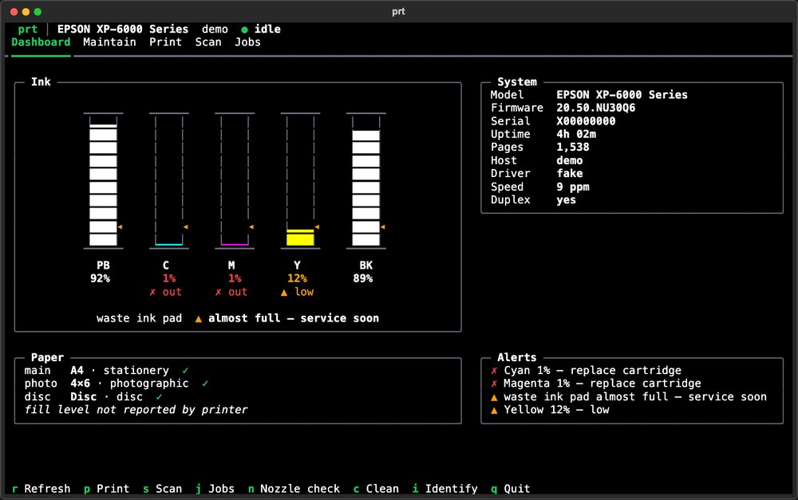</p>

| Key | Action |
|---|---|
| `r` | Refresh (auto-refreshes every 10 s) |
| `n` / `c` / `i` | Nozzle check / head cleaning (both ask first) / identify |
| `p` / `s` / `j` | Print, Scan, Jobs tabs |
| `1`–`9` | Switch between saved printers |
| `q` | Quit |

## Photo booth

`prt booth photo.jpg` prints the photo as a newspaper front page with a short news story, or as a themed card or poster. With no story each style uses its own built-in text.

```bash
prt booth astronaut.jpg --story-file story.json --preview metro.jpg         # metro, the default
prt booth astronaut.jpg --style daily --story-file story.json -o daily.jpg  # -o is short for --preview
prt booth astronaut.jpg --style wizard -o wizard.jpg                        # built-in story
prt booth astronaut.jpg --style wanted --headline "Captain Moonboots" --yes # print it, no prompt
prt booth cat.jpg --style missing --headline "Mittens" --byline "Call 555-0199" -o missing.pdf
```

<table><tr><td align="center"><br><code>metro</code></td><td align="center"><br><code>daily</code></td><td align="center"><br><code>wizard</code></td><td align="center"><br><code>wanted</code></td></tr><tr><td align="center">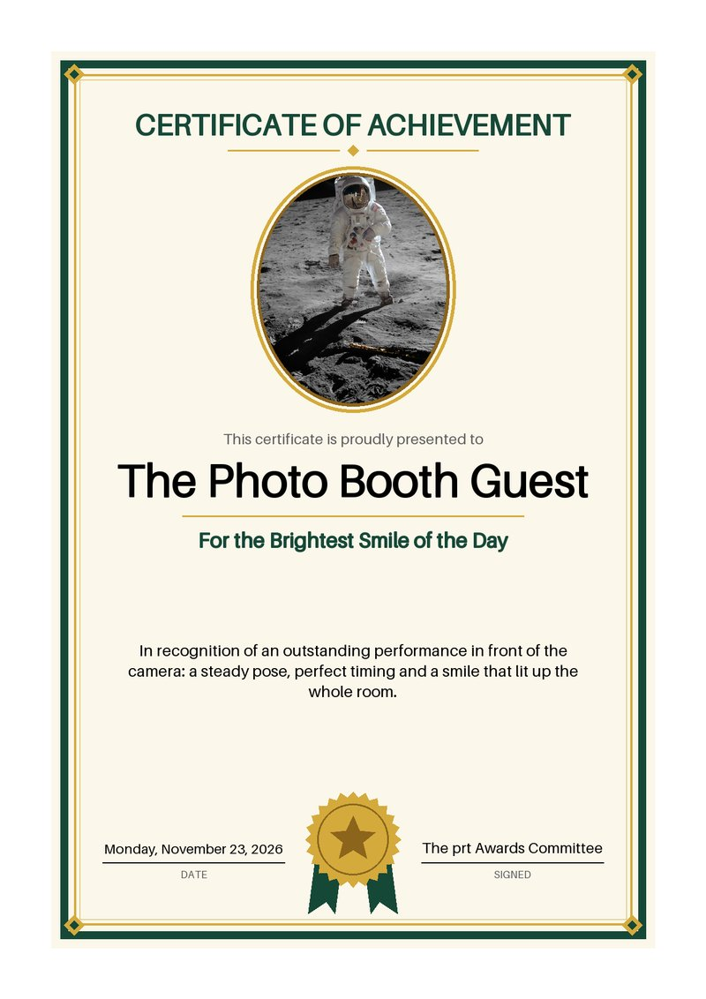<br><code>certificate</code></td><td align="center">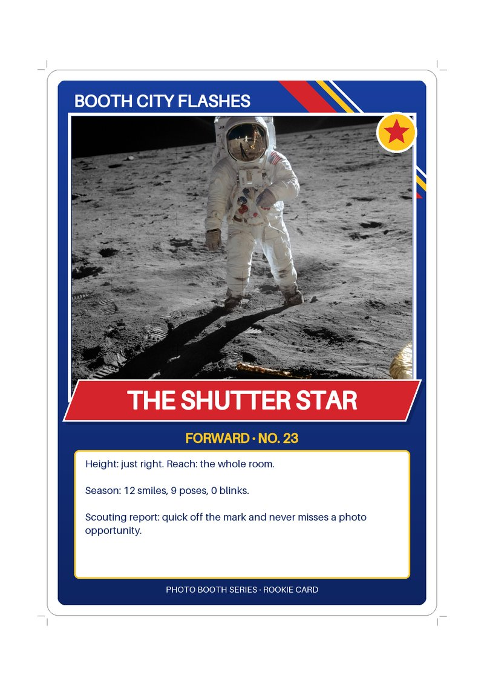<br><code>sports</code></td><td align="center">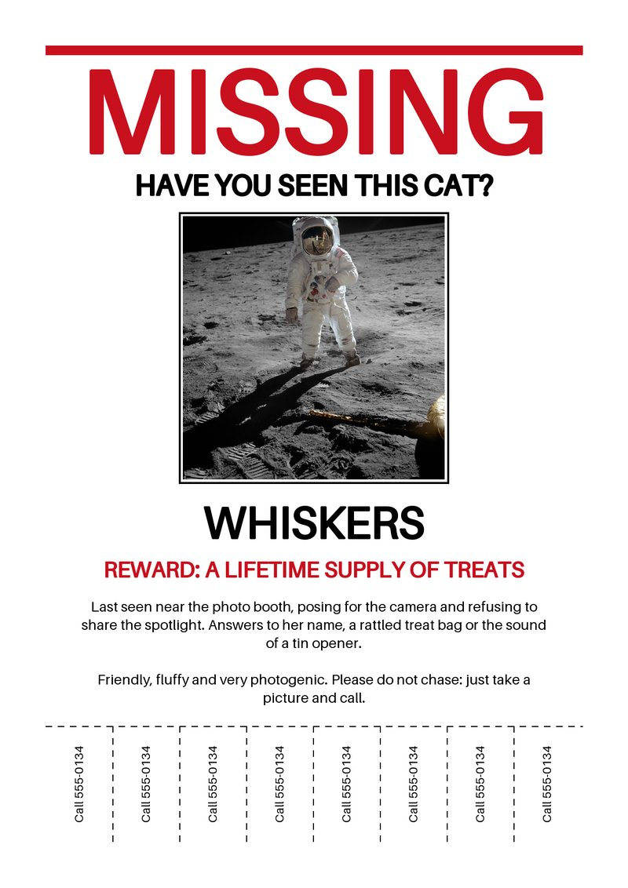<br><code>missing</code></td><td align="center">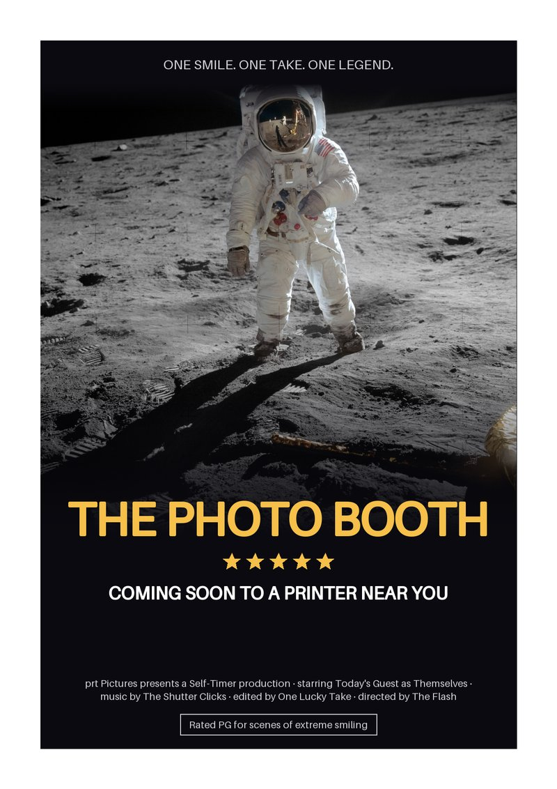<br><code>movie</code></td></tr></table>

The `metro` and `daily` samples use [story.json](https://github.com/luongnv89/printer-cli/blob/main/assets/samples/story.json); the other styles use their built-in text.

- `--style metro` (default) is a colour tabloid with two columns. `--style daily` is a black-and-white broadsheet with three columns.
- `--style wizard` is an ornate trading card: a dark card with a gold double border and cut marks, the photo in an arched gold frame, a moon-and-star emblem, a name ribbon and a lore box. `--style wanted` is a weathered parchment poster: huge WANTED lettering, the photo in a heavy frame, a "dead or alive" line, the name and a reward.
- `--style certificate` is an award certificate: ivory paper in a green-and-gold border, the title, the photo in an oval gold frame, "This certificate is proudly presented to" the name, the award, a citation, a date line filled in with today's date, a signature line and a gold seal. `--style sports` is a sports trading card: a royal-blue card with red and yellow stripes and cut marks, the team at the top, a full-width photo with a star badge, the name on a slanted red bar, the position and a stats box.
- `--style missing` is a missing-pet poster: huge red MISSING lettering, the question ("Have you seen this cat?"), the photo in a black frame, the name, a red reward line, a description, and a row of tear-off tabs along the foot that each carry the contact. `--style movie` is a movie poster: a dark poster with the tagline at the top, the photo fading into the dark, the title in large gold capitals, five stars, the release line, the credits block and a rating box.
- The themed styles reuse the story fields: `headline` is the name (the film title on `movie`), `kicker` the card type (wizard), the "dead or alive" line (wanted), the title (certificate), the team (sports), the question (missing) or the tagline (movie), `caption` the subtitle (wizard), the reward line (wanted, missing), the award (certificate), the position (sports) or the release line (movie), `story` the lore, description, citation, stats or credits, and `byline` the footer (wizard, wanted, sports), the signature (certificate), the contact on the tear-off tabs (missing) or the rating (movie). `prt styles -f json` gives each style's own field descriptions. Without them, each style prints its own example: `wanted` prints "The Grinning Captain" with a reward of 1,000,000 gold, and `missing` Whiskers the cat.
- Write your own story as JSON: `headline` and `story` are required, `kicker`, `caption` and `byline` are optional. Pass it with `--story-file story.json`, or pipe it in with `--story-file -` to read it from stdin, so no file has to be written. `--headline`, `--story`, `--kicker`, `--caption` and `--byline` override single fields.
- The page uses the font that ships with Pillow, which covers basic Latin only. Accents print without their marks, and other scripts and emoji are refused with an error.
- `--preview page.jpg` saves the page without printing. The file name picks the type: `.jpg`/`.jpeg` (JPEG), `.png` (lossless image) or `.pdf` (one A4 page); any other name is refused.
- `--save page.pdf` keeps a digital copy and still prints the page. Repeat it for more files, e.g. `--save page.pdf --save page.png`. Copies are written before the printer is contacted, so they are kept even if printing is declined or the printer is asleep.
- The length limits (headline 120, story 2500, kicker 40, caption 200, byline 80 characters) are what the command accepts, not what always fits. `metro` has the least room: about 70 characters of headline on two full-size lines, about 100 on three smaller ones, and about 100 characters of caption under a portrait photo.
- Text too long for its space is cut with `…` after the last whole word that fits, and `prt booth` warns on stderr naming the fields that were cut. With `-f json` the output says the same in a fit report: `"fits": false` and, for each cut field in page order, how many of its characters were printed and how many were given, e.g. `"cut": {"headline": {"max_fit": 68, "given": 92}}`. Shortening the field to `max_fit` characters makes it fit, so a script or agent can cut the text and try again. When everything fits the report is `"fits": true, "cut": {}`. Transparent parts of a PNG print as white paper.
- The photo and story are checked before anything is sent, so an unreadable image or a bad story file exits with an error and prints nothing.

To let an AI agent look at the photo and write a story that fits it, give it the [photo-booth skill](https://github.com/luongnv89/printer-cli/blob/main/skills/photo-booth/SKILL.md): `prt skills install` puts it where the agent finds it (see [Agent skills](#agent-skills)).

## Greeting card

`prt card photo.jpg` prints a greeting card: the photo and a verse on one A4 sheet that folds into an A6 card with every panel the right way up. With no text it prints its own "Best Wishes" card.

```bash
prt card me.jpg --greeting "Happy Birthday!" --verse $'Roses are red,\nthe sky is blue.' -o card.pdf   # nothing printed
prt card me.jpg --card-file card.json --yes                                                       # print it
printf '%s' '{"greeting": "Thank You", "verse": "..."}' | prt card me.jpg --card-file - --yes      # card on stdin
```

<p align="center">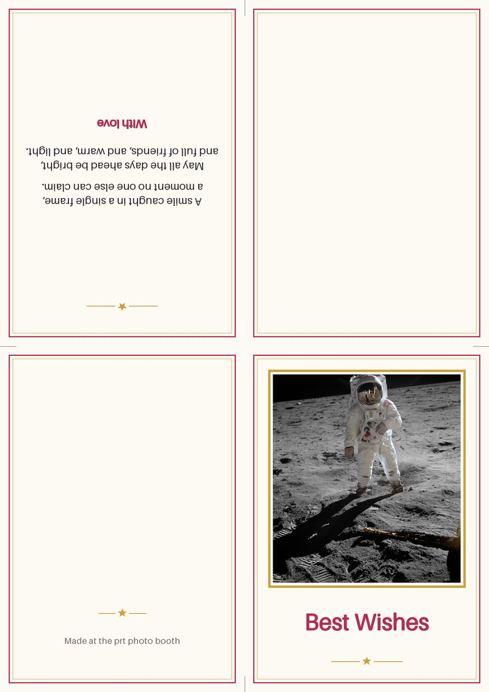</p>

**Fold it** in half from top to bottom with the printed side out, then in half again with the photo on the front. The sheet holds four panels: the front (the photo in a gold frame and the greeting) bottom right, the back bottom left, and the two inside panels on the top half, printed upside down so that they read the right way up once folded. Short marks at the edges of the sheet show where the folds go. It prints on one side of the paper, so no duplex is needed.

| Field | Required | Max characters | Printed |
|---|---|---|---|
| `greeting` | yes | 60 | Large, on the front under the photo |
| `verse` | yes | 600 | Inside right, centred: each newline starts a new line, a blank line a new stanza |
| `message` | no | 300 | Inside left, centred (a newline starts a paragraph); without one that panel is left blank to write on |
| `signature` | no | 80 | Under the verse |
| `back` | no | 80 | A small line on the back |

- Write the text as a JSON card file and pass it with `--card-file card.json`, or pipe it in with `--card-file -`. `--greeting`, `--verse`, `--message`, `--signature` and `--back` override single fields. `prt schema card` prints the file's JSON Schema.
- The verse is set as large as it fits, keeping each of its lines on one line when smaller type allows it. Text too long for its panel is cut with `…`, the command warns, and with `-f json` the output carries the same fit report as `prt booth` (`fits`, and `cut` with `max_fit` and `given` for each cut field), the `estimate` and the folding instructions (`fold`).
- `--preview`/`-o` saves the sheet without printing, and `--save` keeps a copy and prints, as in `prt booth`. A file name that would overwrite the photo or the card file is refused with exit code 2.
- The photo and the card are checked before anything is sent: an unreadable photo or a bad card file exits with code 3 and prints nothing. The text font covers Latin letters, as in the photo booth.

The [greeting-card skill](https://github.com/luongnv89/printer-cli/blob/main/skills/greeting-card/SKILL.md) has an AI agent look at the photo, write a verse for it and the occasion, preview the card and print it (`prt skills install` installs it).

## Comic strips

`prt comic` prints 3 to 6 photos as the panels of a comic page on A4, with speech bubbles, thought bubbles and captions written in a JSON comic file. With no comic file it prints its own "The Big Day" comic.

```bash
prt comic a.jpg b.jpg c.jpg d.jpg --comic-file comic.json -o comic.png   # nothing printed
prt comic a.jpg b.jpg c.jpg --comic-file comic.json --yes                # print it
prt comic a.jpg b.jpg c.jpg -f json -o comic.png | jq '{fits, cut}'      # check that every bubble fits
```

<p align="center">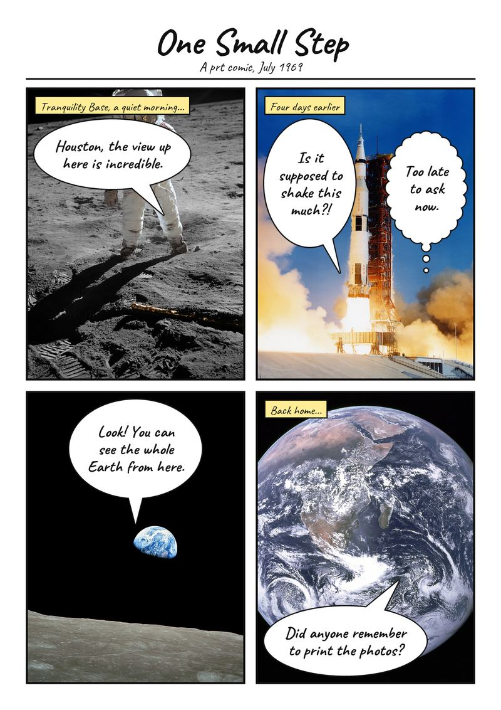</p>

The sample uses [comic.json](https://github.com/luongnv89/printer-cli/blob/main/assets/samples/comic.json).

The photos are the panels in reading order, row by row from the top: 3 photos make one wide panel over two, 4 make a 2×2 grid, 5 make two, one wide and two, and 6 make three rows of two. Each photo is cropped to fill its panel. The comic file has one panel per photo, in the same order:

```json
{"title": "One Small Step", "byline": "A prt comic",
 "panels": [
  {"caption": "Tranquility Base", "bubbles": [{"text": "Houston, the view is incredible.", "tail": "right"}]},
  {"bubbles": [{"text": "Is it supposed to shake?!"}, {"text": "Too late now.", "kind": "thought"}]},
  {"bubbles": [{"text": "Did anyone print the photos?", "position": "bottom-left"}]}
 ]}
```

| Field | Max characters | Printed |
|---|---|---|
| `title` | 60 | Large handwriting above the panels, on one line (`--title` overrides it) |
| `byline` | 60 | Under the title (`--byline` overrides it) |
| `panels[].caption` | 100 | A yellow narration box in the panel's top-left corner, on up to two lines |
| `panels[].bubbles[].text` | 140 | The words in one bubble; up to 3 bubbles a panel |

- `position` puts a bubble in the `top` or `bottom` band of its panel: `top-left`, `top`, `top-right`, `bottom-left`, `bottom` or `bottom-right`. Without one, a panel's first bubble goes top-left, the second top-right and the third bottom-right. Bubbles in the same band share its width, from left to right, each later one set a little further in from the edge of the panel.
- `tail` points the bubble at the speaker: down out of a top bubble, up out of a bottom one, towards the `left`, the `center` (the default) or the `right`; `none` leaves it off. `kind` is `speech` (an oval with a pointed tail, the default) or `thought` (a cloud with a trail of puffs).
- Each bubble and caption is set in the bundled Caveat handwriting font, as large as fits its space. Text that still does not fit is cut with `…`, the command warns, and with `-f json` the fit report names it by where it is in the file, e.g. `"cut": {"panels[1].bubbles[0]": {"max_fit": 52, "given": 120}}`. Shortening that text to `max_fit` characters makes it fit. Fewer bubbles in a band, or the band to itself, give a bubble more room.
- Pass the file with `--comic-file comic.json`, or pipe it in with `--comic-file -`. `prt schema comic` prints its JSON Schema. A comic file with more or fewer panels than photos, or fewer than 3 or more than 6 photos, is refused with exit code 2; a bad comic file exits with code 3 and prints nothing. The font has Latin and Cyrillic letters; emoji and other scripts are refused.
- `--preview`/`-o` saves the page without printing, and `--save` keeps a copy and prints, as in `prt booth`. A file name that would overwrite a photo or the comic file is refused with exit code 2. With `-f json` the output gives the number of `photos`, the `title`, the `paper`, the fit report and the `estimate`.

## 4×6 photo prints

`prt strip` and `prt instant` print on 4×6 in (10×15 cm) photo paper from the printer's photo tray, at 300 dpi. Load the paper first: the confirmation prompt names the tray.

```bash
prt strip a.jpg b.jpg c.jpg d.jpg --caption "Anna & Ben · 24.11.2026" -o strip.png   # nothing printed
prt strip a.jpg b.jpg c.jpg d.jpg --mono --yes                                       # classic black and white
prt instant me.jpg --caption "Summer at the lake" --yes                              # print it
prt instant me.jpg --caption "" -o instant.pdf                                       # blank, to write on by hand
```

<table><tr><td align="center">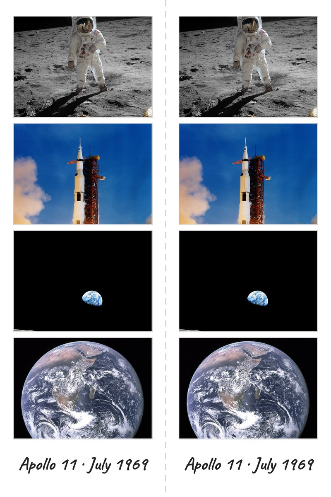<br><code>strip</code></td><td align="center">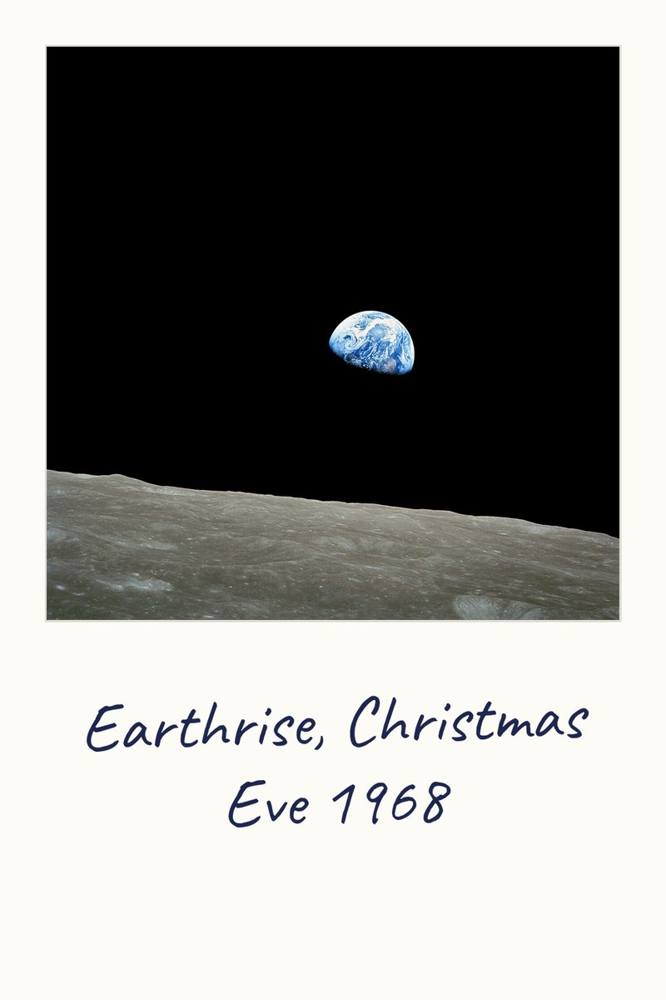<br><code>instant</code></td></tr></table>

- **`prt strip`** takes four photos, in the order of the frames from the top, and lays them out in a column the way a photo booth does, with a handwritten caption at the foot. The column is printed twice side by side: cut the sheet along the dashed line for two 2×6 in strips. `--mono` prints the photos in black and white. Another number of photos is a usage error (exit code 2); repeat a photo to use it twice.
- **`prt instant`** prints one photo, cropped square, in a wide white frame with a handwritten caption under it, like an instant-camera print (Polaroid-style).
- `--caption` sets the caption (up to 60 characters on the strip, 80 on the instant photo); without it, today's date is written, and `--caption ""` leaves the space blank. It is set in Caveat, a handwriting font that ships with prt: accents print, emoji and scripts the font lacks are refused with exit code 2. A caption too long for its space is cut with `…`, and the `-f json` line carries the same fit report as `prt booth` (`fits`, `cut`).
- `--preview`/`-o` saves the print without printing (`.pdf` is a 4×6 in page), and `--save` keeps a copy and prints, as in `prt booth`. A file name that would overwrite a photo is refused with exit code 2.
- Each print is one page for the page caps. With `-f json` the line carries the `paper` (`{"size": "4x6", "media": "4x6", "tray": "photo"}`) and an `estimate` whose ink counts the 4×6 sheet's area, not a full A4 page (`"summary": "~1 page (4×6), colour, est. ink 1%"`).

## Colouring pages

`prt colour-in` turns a photo into black line art on white: a colouring page for kids (or anyone) to fill in with crayons. It prints on A4 with black ink only.

```bash
prt colour-in dog.jpg -o page.png       # look at it first: nothing printed
prt colour-in dog.jpg --yes             # print it
```

<p align="center">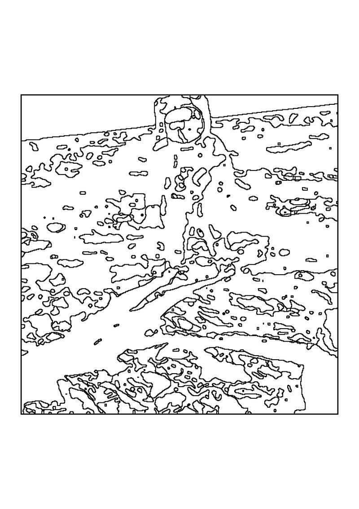</p>

- The photo is smoothed and cut into a few flat tones, and the outlines between the tones are drawn as black lines, so the shapes come out mostly closed and each can be coloured in. Texture such as grass, fabric or skin is smoothed away first.
- The whole photo is printed, never cropped, centred in a black frame that closes the shapes its edges cut through. The page is upright for a portrait or square photo and on its side for a landscape one.
- Every pixel is pure black or white, so the `-f json` `estimate` reports `"colour": false` and only black ink. Photos with clear shapes and contrast (a pet, a toy, a face close up, a building) give the cleanest pages; a busy or low-contrast photo gives many small shapes.
- `--preview`/`-o` saves the page without printing, and `--save` keeps a copy and prints, as in `prt booth`. A file name that would overwrite the photo is refused with exit code 2, and a photo that cannot be read with exit code 3. The page counts as one page for the page caps, and with `-f json` the line carries the `paper`, the fit report (always `"fits": true`: there is no text) and the `estimate`.

## Postcards

`prt postcard photo.jpg` prints a postcard on 4×6 in (10×15 cm) photo paper from the photo tray, read on its side: the photo on the front, and on the back the message and a signature on the left, a stamp box and four address lines on the right. With no text it prints its own "Greetings from afar" postcard.

```bash
prt postcard beach.jpg --message "Wish you were here!" --address "Jo Smith" --address "12 High Street" -o card.pdf  # nothing printed
prt postcard beach.jpg --postcard-file postcard.json                     # at a terminal: front, turn the card over, back
prt postcard beach.jpg --postcard-file postcard.json --side front --yes  # scripts and agents: one side at a time…
prt postcard beach.jpg --postcard-file postcard.json --side back --yes   # …after turning the card over
prt postcard beach.jpg --postcard-file postcard.json --duplex --yes      # one two-sided job, for a printer whose duplexer takes the card
```

<p align="center">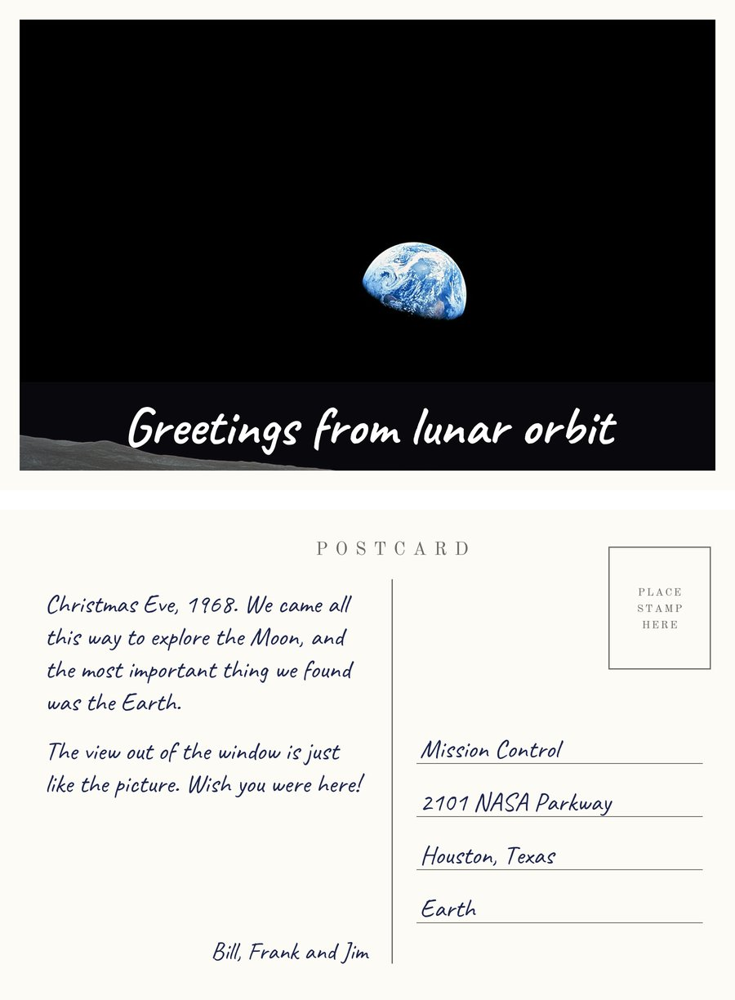</p>

| Field | Required | Max characters | Printed |
|---|---|---|---|
| `greeting` | no | 60 | In handwriting across the foot of the photo, on a dark band so it reads on any photo; `--greeting ""` prints the photo alone |
| `message` | yes | 500 | On the left of the back, as large as it fits (a newline starts a paragraph) |
| `signature` | no | 60 | Under the message |
| `address` | no | 160 | On the ruled lines right of the divider, one line of text per line, up to 4; without it the lines are left blank to write on |

- Write the text as a JSON postcard file and pass it with `--postcard-file postcard.json`, or pipe it in with `--postcard-file -`. `--greeting`, `--message` and `--signature` override single fields, and `--address` (repeated, one line each) the address. `prt schema postcard` prints the file's JSON Schema. The text is set in Caveat, the handwriting font of the other 4×6 prints: accents print, emoji and scripts the font lacks are refused. Text too long for its space is cut with `…`, and the `-f json` line carries the same fit report as `prt booth` (`fits`, `cut`).
- **Both sides on one card.** When the printer can turn the card over itself, both sides go in one two-sided job, flipped on the short edge so the back reads the right way up when the card is turned over like a book page. That job goes through the printer's CUPS queue as a two-page PDF, because the printer takes one image per job directly. Inkjet duplexers take plain paper from the main tray, not photo card, so prt only does this when asked with `--duplex`; it is refused (exit 1, kind `duplex_unavailable`) when the printer does not report two-sided printing or has no CUPS queue.
- **Otherwise the card is turned over by hand.** At a terminal, prt prints the front, asks you to put the card back in the photo tray turned over (the blank side facing the way the photo side did, with the same edge going in first) and prints the back when you say so; answering no keeps the front and prints nothing more. The back is sent turned a half turn for this, so it lines up with the front. Try it once on a plain sheet to see which way your printer takes the card. Without a terminal, and always in agent mode, printing both sides this way is refused before anything is sent (exit 2, kind `manual_flip_required`): print `--side front`, turn the card over, then print `--side back`.
- `--preview`/`-o` saves both sides without printing: a `.pdf` is one file with the front then the back, a `.png`, `.jpg` or `.jpeg` name gives two files, `NAME-front` and `NAME-back`. `--save` keeps a copy the same way and prints. A file name that would overwrite the photo or the postcard file is refused with exit code 2.
- Each side is one page for the page caps and the `estimate` (`"~2 pages (4×6), …"`), and `--side` counts only the side it prints. With `-f json` the line also has the `paper`, the `method` (`duplex`, `flip`, `front` or `back`), the `jobs` by side (`{"front": 101, "back": 102}`; the same id twice for a two-sided job, `"back": null` when the back was not printed) and, for a card turned by hand, the `flip` instructions.

## Disc labels

`prt disc photo.jpg` prints a circular label straight onto a printable 12 cm CD or DVD through the printer's disc tray, for a mixtape, a wedding playlist or a game-night disc. The photo fills the printable ring, the title and a subtitle are written above the hub, the tracks run in two columns either side of it and a footer line sits at the foot. With no text it prints its own "Road Trip Mix" label.

```bash
prt disc beach.jpg --title "Road Trip Mix" --track "1. Open Road" --track "2. Windows Down" -o disc.png  # nothing printed
prt disc beach.jpg --disc-file disc.json --preview disc.pdf -f json   # check the fit and the ink first
prt disc beach.jpg --disc-file disc.json --yes                        # print it: load a printable disc first
```

<p align="center">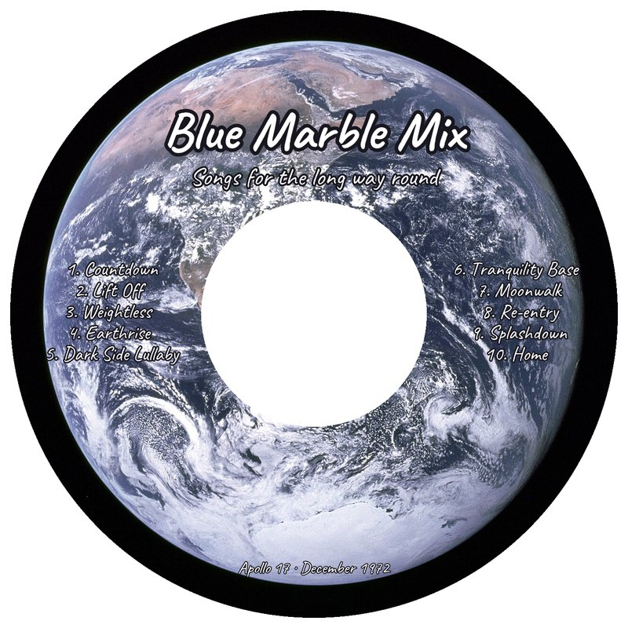</p>

| Field | Required | Max characters | Printed |
|---|---|---|---|
| `title` | yes | 60 | In large handwriting above the hub; on two lines when it is long |
| `subtitle` | no | 80 | Under the title, e.g. the date or the occasion |
| `tracks` | no | 80 each, up to 24 tracks | In two columns either side of the hub, the first half on the left, each track on one line as written: number them yourself (`"1. Open Road"`) |
| `footer` | no | 60 | A small line at the foot of the label |

- Write the label as a JSON file and pass it with `--disc-file disc.json`, or pipe it in with `--disc-file -`. `tracks` is a list of texts, or one text with a newline between tracks; empty tracks are dropped. `--title`, `--subtitle` and `--footer` override single fields, and `--track` (repeated, one track each) replaces the whole track list. `prt schema disc` prints the file's JSON Schema. The text is set in Caveat, the handwriting font of the 4×6 prints, off-white with a dark outline so it reads on any photo: accents print, emoji and scripts the font lacks are refused (exit code 3 from a file, 2 from a flag).
- **The printable ring.** The label is drawn on the 120 mm square round the disc at 300 dpi. The photo fills a ring 116 mm across with a 43 mm hole, the printable area most inkjet printers default to on a 12 cm disc, and everything outside the ring, the corners and the hub is left blank, so no ink goes on the tray or the clear centre of the disc. The label goes to the printer as a JPEG, whose compression can leave a faint, near-white haze up to about 2 mm either side of the ring's edges, which stays on the disc, clear of the tray, and well clear of the centre hole. Every line of text is fitted to the width the ring has at its height, so text never reaches the hub or the edge. Text too long for its line is cut with `…`, and the `-f json` line carries the same fit report as `prt booth` (`fits`, `cut`; the `tracks` cut counts the characters of the tracks joined by newlines).
- **Load the disc first.** The label is sent with the disc size (120 × 120 mm), the `disc` media source and the `disc` media type, and the confirmation prompt says to load a printable CD/DVD in the disc tray, printable side up. A printer that lists its trays without a disc tray is refused before anything is sent (exit 1, kind `disc_tray_unavailable`). Use inkjet-printable discs only, and try a plain one first to see where your printer puts the label.
- `--preview`/`-o` saves the label without printing (`.pdf` is a 120 mm square page), and `--save` keeps a copy and prints, as in `prt booth`. A file name that would overwrite the photo or the label file is refused with exit code 2.
- Each label is one page for the page caps. With `-f json` the line carries the `title`, the number of `tracks`, the `paper` (`{"size": "disc", "media": "disc", "tray": "disc"}`) and an `estimate` that counts only the printed ring (`"summary": "~1 page (CD/DVD), colour, est. ink 1%"`).

## Recipe cards

`prt recipe https://example.com/lemon-cake` prints a recipe as 6×4 in index cards on 4×6 photo paper from the photo tray: the title in handwriting over a red rule, then the ingredients and the numbered steps on blue lines in two columns.

```bash
prt recipe https://example.com/lemon-cake -o cake.png   # one PNG per card, nothing printed
prt recipe https://example.com/lemon-cake --yes          # print it
prt recipe recipe.json --save cake.pdf --yes             # a recipe file, with a PDF copy
prt recipe - --yes < recipe.json                         # the recipe on stdin
```

<p align="center">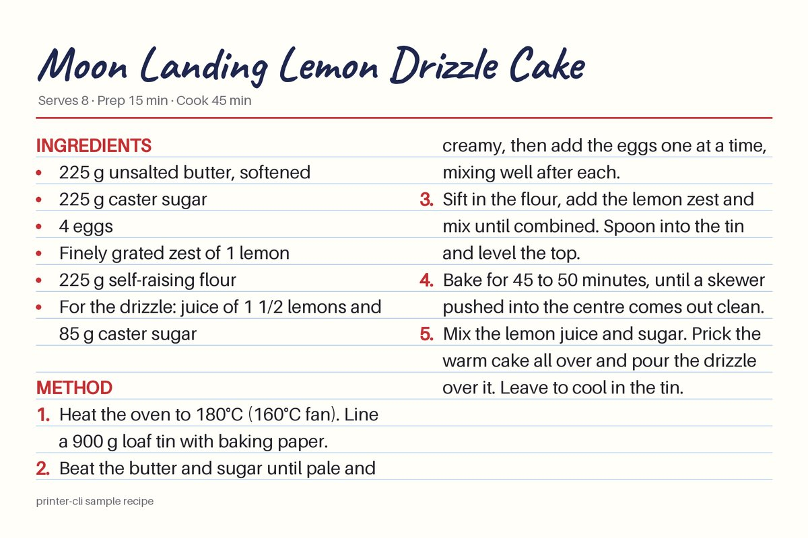</p>

- From a web page the recipe is read from its schema.org `Recipe` data, the JSON-LD most recipe sites publish for search engines: the name, the ingredients, the steps, the yield and the preparation and cooking times. A page without it is read like `prt article` reads one, taking the list under an "Ingredients" heading and the steps under an "Instructions", "Method", "Directions" or "Steps" heading. A page with neither exits with code 3, kind `no_recipe`, and nothing is printed.
- Links are fetched as `prt article` fetches them (`http://` and `https://` only, certificate checks, at most 5 redirects and 5 MiB). For a page the command cannot read, pass a saved file: a recipe JSON file (`{"title": "...", "ingredients": ["..."], "steps": ["..."], "servings": "...", "time": "...", "source": "...", "url": "..."}`; `prt schema recipe` prints its JSON Schema), a saved `.html` page, or a text file with the title on the first line, then an "Ingredients" line and a "Method" line, each followed by one item per line. `prt recipe -` reads the same from stdin.
- The type is set as large as lets the recipe fit on one card. A longer recipe runs on to more cards, numbered `1/2`, `2/2`, up to 6; every ingredient and step is printed, and a recipe that needs more cards is refused with exit code 3. The title is written on one line, or on two smaller ones when it is long; a title too long even for that is cut with `…`, the command warns, and the `-f json` line reports it (`fits`, `cut`). Each card is printed as its own job, upright, after one confirmation prompt.
- `--preview card.pdf` saves the cards without printing (`.pdf` holds every card, `.png`, `.jpg` and `.jpeg` one image per card, laid out on its side), and `--save` keeps the same copies and prints. With `-f json` the line carries the title, the number of cards (`pages`), the `paper`, the fit report and the `estimate`.
- The card font covers Latin letters: accents print without their marks, fractions such as `½` print as `1/2`, emoji are left out, and a recipe mostly in another script is refused.

## Bingo cards

`prt bingo --theme "road trip" -n 8` prints 8 bingo cards, one for each player, each on its own A4 page: the title in handwriting, a row of coloured B-I-N-G-O letters and a 5×5 grid of words round a free centre square. No two cards in a run hold the same set of words.

```bash
prt bingo --theme "road trip" -n 8 --preview cards.pdf      # 8 cards in one PDF, nothing printed
prt bingo --theme zoo -n 6 --yes                            # print them
prt bingo --words-file party.json -n 12 --save cards.pdf    # your own words, with a PDF copy
prt bingo --theme "road trip" -n 8 --seed 4821 --yes        # deal the same cards as an earlier run
```

<p align="center">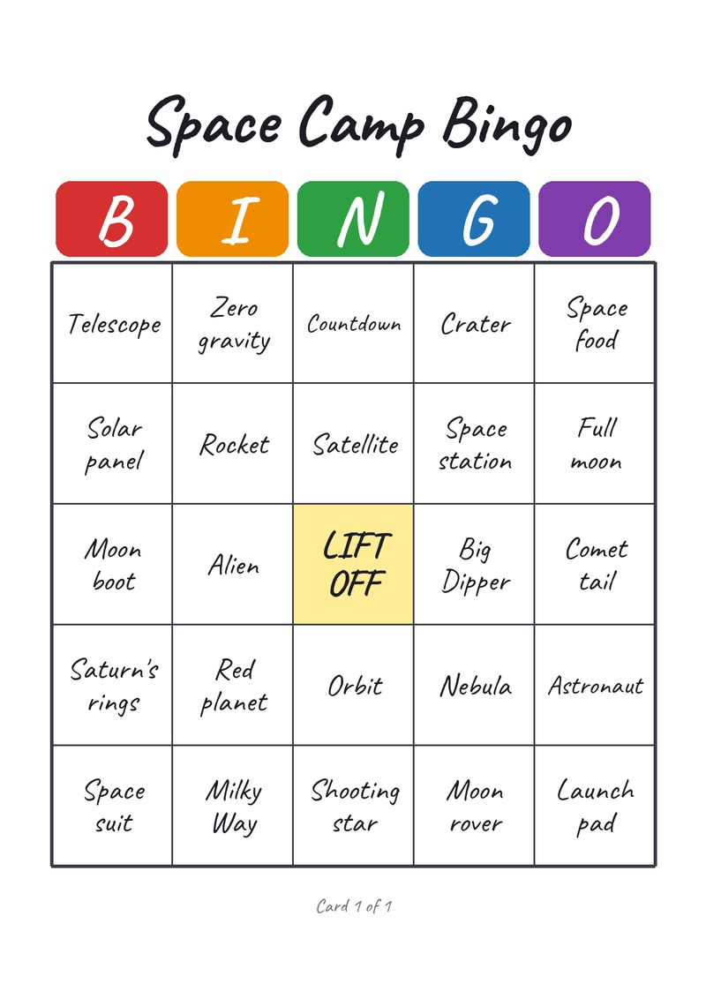</p>

The sample uses [bingo.json](https://github.com/luongnv89/printer-cli/blob/main/assets/samples/bingo.json).

- **Themes.** `--theme` picks a bundled word list: `road trip` (the default), `beach`, `zoo`, `birthday` or `space`, matched without regard to case, with `-` or `_` read as a space. The title is the theme's name, e.g. "Road Trip Bingo". A theme that is not bundled, with no words file, is refused with exit code 2 and kind `unknown_theme`, and nothing is written or printed.
- **Your own words.** For any other game, write the words yourself in a JSON file and pass it with `--words-file words.json`, or pipe it in with `--words-file -`: `{"title": "Office Bingo", "free": "COFFEE", "words": ["...", "..."]}`. `words` is required: at least 25, up to 200, of up to 24 characters each, no two the same (ignoring case and spacing). `title` (up to 60 characters) and `free`, the text of the centre square (up to 12, `FREE` by default), are optional. With a words file `--theme` can be any text and only names the game: the title is the file's `title`, else "<theme> Bingo", else "Bingo". `prt schema bingo` prints the file's JSON Schema; a bad words file exits with code 3 and says which word is wrong, e.g. `words[12] repeats words[3] ('Tractor')`.
- **Every card different.** Each card takes 24 of the words, in a random order, and every card in a run takes a different set of them, so no two players can hold the same card. `-n`/`--cards` sets how many cards, 1 (the default) to 30. 25 words make only 25 different cards; asking a 25-word file for more is refused with exit code 3 (26 words already make 325).
- **Deal it again.** The deal is random. The `-f json` line and the note after the run give its `seed`, and `--seed N` deals the same cards from the same words again, e.g. to reprint a lost card.
- Each word is set in the bundled Caveat handwriting as large as fits its square, on up to four lines. The font has Latin and Cyrillic letters: accents print, and emoji or scripts it lacks are refused (exit code 3 from a file, 2 from `--theme`). A title too long for two lines is cut with `…`, the command warns, and the `-f json` line reports it (`fits`, `cut`).
- `--preview`/`-o` saves the cards without printing: `.pdf` holds every card, `.png`, `.jpg` and `.jpeg` one image per card (`cards-1.png`, `cards-2.png`, …). `--save` keeps the same copies and prints. A file name that would overwrite the words file is refused with exit code 2.
- Each card is one page and one job, so the page caps count every card: in agent mode the per-run cap of 10 refuses `-n 12` whole before anything is sent (kind `page_cap_exceeded`). With `-f json` the line carries the `title`, the bundled `theme` (`null` with a words file), the number of cards (`pages`), the `seed`, the number of `words` dealt from, the `paper`, the fit report and the `estimate`.

## Puzzles

`prt puzzle sudoku`, `prt puzzle wordsearch`, `prt puzzle crossword` and `prt puzzle maze` print a puzzle on an A4 page, and keep its solution so you, or an agent, can check the filled-in sheet later.

```bash
prt puzzle sudoku --difficulty hard --preview sudoku.png              # look first, nothing printed
prt puzzle sudoku --difficulty hard --seed 4821 --answers key.json --yes   # print it, and keep the answers
prt puzzle wordsearch --theme zoo --difficulty easy --yes             # words from a bundled theme
prt puzzle wordsearch --words-file words.json --title "Our Holiday"   # your own words
prt puzzle crossword --crossword-file crossword.json --answers key.json --yes
prt puzzle maze --difficulty easy --yes
```

<table><tr><td align="center">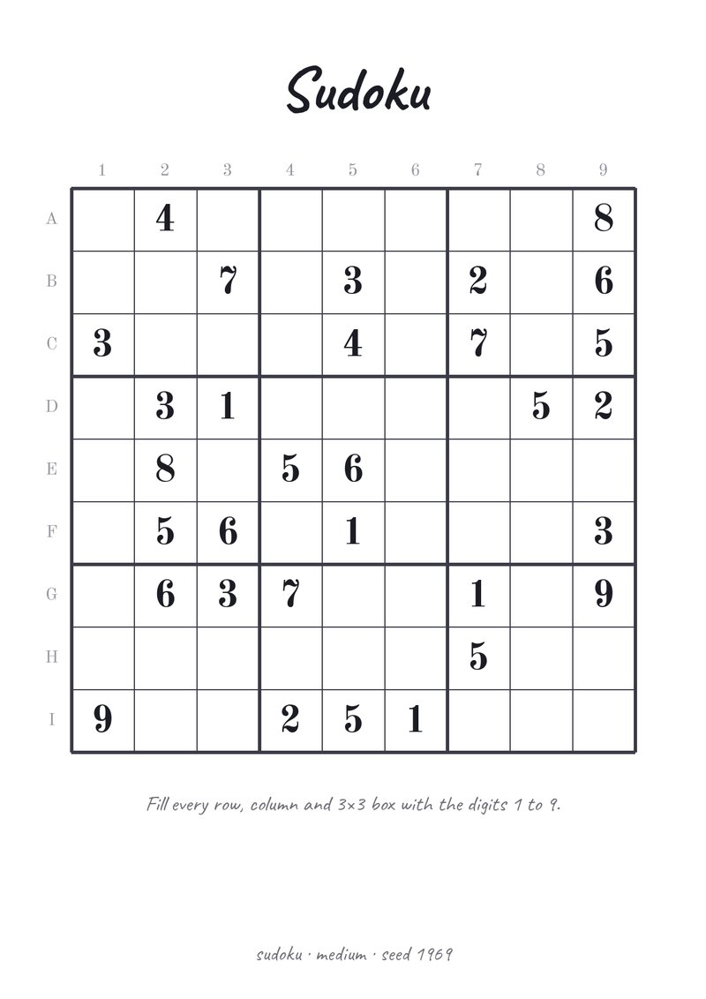<br><code>sudoku</code></td><td align="center">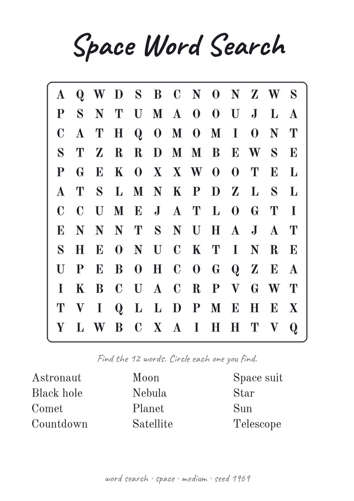<br><code>wordsearch</code></td><td align="center">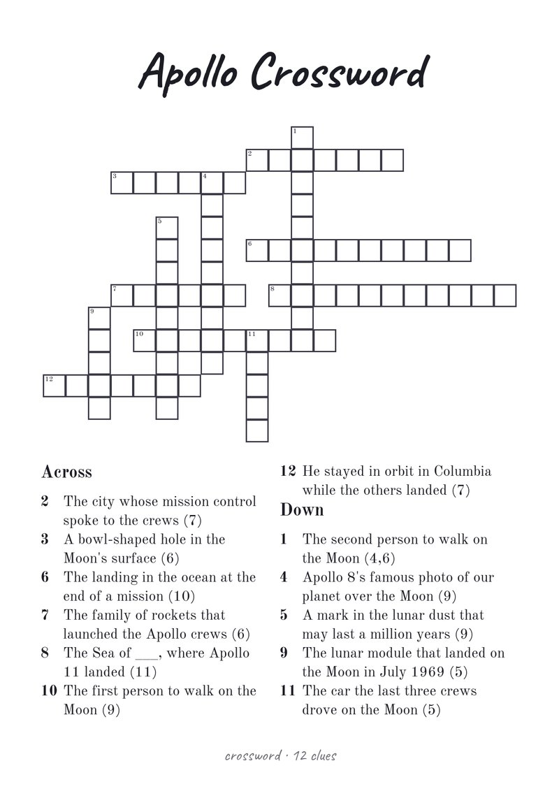<br><code>crossword</code></td><td align="center">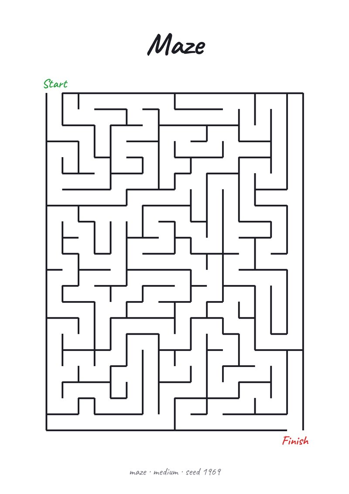<br><code>maze</code></td></tr></table>

The crossword sample uses [crossword.json](https://github.com/luongnv89/printer-cli/blob/main/assets/samples/crossword.json); the others use a seed and a bundled theme.

- **Sudoku.** A 9×9 grid with exactly one solution. `--difficulty` (`-d`) `easy`, `medium` (the default) or `hard` gives 38, 31 or about 26 digits. The rows are labelled A to I and the columns 1 to 9, so a square can be named, e.g. `C7`.
- **Word search.** Words hidden in a square of letters, listed under it. `--theme` picks a random handful from a bundled list (the bingo themes: `road trip`, the default, `beach`, `zoo`, `birthday` or `space`); `--words-file words.json` (or `-` for stdin) hides your own: `{"title": "Our Holiday", "words": ["Beach", "Sandcastle", "Ice cream"]}`, 3 to 20 words of 3 to 15 letters, no two the same. Spaces, hyphens and apostrophes are left out of the grid, and accents are dropped. `easy` is a 10×10 grid with words running forwards and down, `medium` 13×13 and also diagonally, `hard` 15×15 and any of the eight ways, backwards too; a longer word makes the grid bigger, up to 15. `prt schema wordsearch` prints the file's JSON Schema.
- **Crossword.** Write the answers and clues in a JSON crossword file, `--crossword-file crossword.json` (or `-` for stdin): `{"title": "Apollo Crossword", "entries": [{"answer": "Armstrong", "clue": "The first person to walk on the Moon"}, …]}`, 2 to 20 entries, each answer 2 to 15 letters. prt lays the answers out so that each crosses another, in a grid of at most 21×21 squares, numbers them, and prints the Across and Down clues with each answer's letter count, e.g. `(4,6)` for "Buzz Aldrin". The layout depends on the entries alone, so the same file always makes the same crossword. An answer that cannot be made to cross the others is refused with exit code 3, naming it (e.g. `entries[4] ('Xylophone') cannot cross the other answers`); give it a partner with a shared letter or leave it out. Without a file, a built-in space crossword is printed. `prt schema crossword` prints the file's JSON Schema.
- **Maze.** One way through, from Start at the top left to Finish at the bottom right: 10×13 squares when `easy`, 16×21 when `medium`, 24×32 when `hard`.
- **The solution.** With `-f json` the line carries the puzzle's `kind`, `title`, `seed`, `difficulty` and its `solution`: the sudoku's `puzzle` and solved `grid` row by row (A to I), the word search's `grid` and each word's start `row` and `col`, `direction` and `cells`, the crossword's `across` and `down` answers by number with their `row`, `col` and clue, and the maze's `path` of squares from start to finish (rows and columns count from 1). `--answers key.json` saves the same object to a file before anything is printed, also with `--preview`.
- **Make it again.** The sudoku, word search and maze are random: the `-f json` line, the note after the run and the foot of the page give the `seed` (e.g. `sudoku · hard · seed 4821`), and `--seed N` with the same options makes the same puzzle again, so a printed sheet is enough to get its answers back; a themed word search names its theme there too (`word search · zoo · easy · seed 17`), and the JSON line gives it as `theme`. Preview first, then print with the seed the preview reported, so the page you print is the one you looked at. A word search from a words file needs the same file too.
- **Check a filled-in sheet.** Scan the finished puzzle with `prt scan --format jpeg -o filled.jpg` and compare it with the answers. The `puzzle-check` [agent skill](#agent-skills) does this: it prints the puzzle with `--answers`, scans the sheet back, reads what was written and reports what is right, wrong and missing.
- `--title` sets the title (up to 60 characters). `--preview`/`-o` saves the page without printing, `--save` keeps a copy and prints, and printing goes through the print guard as one A4 page. A file name that would overwrite the words or crossword file is refused with exit code 2, and so is an `--answers` name that does not end in `.json`.

## Article printing

`prt article https://example.com/blog/post` prints a web article as A4 magazine pages. It keeps the title, author, site name and the full text, and leaves out navigation, ads, share bars, comments and other page clutter.

```bash
prt article https://example.com/blog/post                          # fetch, confirm, print
prt article article.json --preview article.png                     # one PNG per page, nothing printed
prt article article.json --style classic-magazine -o article.pdf   # every page in one PDF
prt article https://x.com/user/status/1234567890 --yes             # one public X post
prt article - --yes < article.json                                 # the article on stdin
```

<table><tr><td align="center"><br><code>magazine</code></td><td align="center">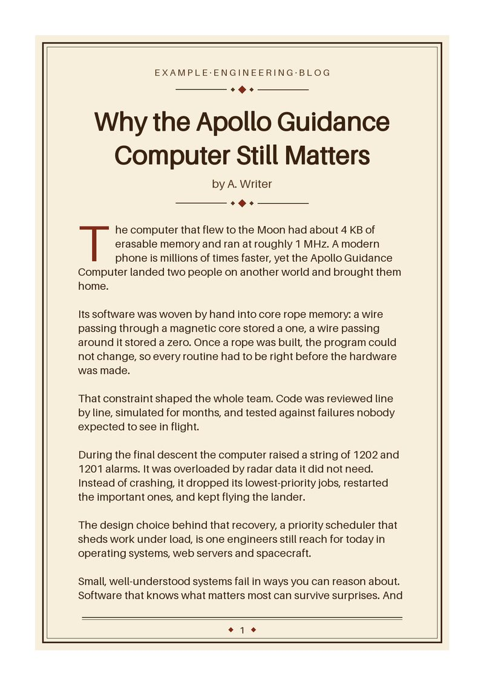<br><code>classic-magazine</code></td></tr></table>

Both samples are page 1 of [article.json](https://github.com/luongnv89/printer-cli/blob/main/assets/samples/article.json).

- `--style magazine` (default) is a white page with a blue accent bar and section label, a big bold headline and three ruled columns. `--style classic-magazine` is an ivory page in a double-rule frame with a centred headline between fleurons, one centred column and a drop cap.
- Long articles run on over as many pages as they need, up to 30; nothing is cut. Each page is printed as its own job, after one confirmation prompt (`--yes` skips it).
- Links must start with `http://` or `https://`. Pages are fetched with certificate checks, at most 5 redirects and 5 MiB, within the `--timeout` (default 5 s).
- X posts (`https://x.com/<user>/status/<id>`, also `twitter.com`) are read through X's public oEmbed service, which returns the text of one public post only: no images, no threads, nothing behind a login.
- For pages the command cannot read (a login wall, text built by JavaScript, a long X thread), pass a saved file instead: article JSON (`{"title": "...", "author": "...", "source": "...", "url": "...", "body": ["paragraph", "..."]}`), a saved `.html` page, or a text file whose first line is the title. `prt article -` reads the same from stdin: JSON when the input starts with `{`, HTML when it starts with `<`, else plain text, up to 5 MiB. The [article-print skill](https://github.com/luongnv89/printer-cli/blob/main/skills/article-print/SKILL.md) lets an AI agent fetch the article itself and write that JSON; `prt skills install` installs it.
- `--preview page.pdf` saves the pages without printing: a `.pdf` holds every page, while `.png`, `.jpg` or `.jpeg` save one image per page (`page-1.png`, `page-2.png`, …). `--save` keeps the same copies and still prints.
- The page font covers Latin letters only: accents print without their marks, emoji are left out, and an article mostly in another script is refused.
- When the article cannot be fetched or converted, `prt article` exits with code 3 and a hint, and nothing is sent to the printer.

## Vintage gazette

`prt gazette photo.jpg` prints a photo as the front page of an old newspaper, after the look of [luongnv.com/news](https://luongnv.com/news): cream paper and one dark ink, a blackletter masthead between double rules, a small-caps dateline, a headline in capitals, the photo toned from ink to paper, and a short story in two ruled columns. With no story it prints its own.

```bash
prt gazette me.jpg --headline "Local Star Steps Out" --preview page.pdf   # one photo, one page, nothing printed
prt gazette trip-1.jpg trip-2.jpg trip-3.jpg trip-4.jpg --save trip.pdf   # four photos on two pages, printed
prt gazette a.jpg b.jpg c.jpg --landscape -o page.pdf                     # A4 on its side, nothing printed
```

<table><tr><td align="center">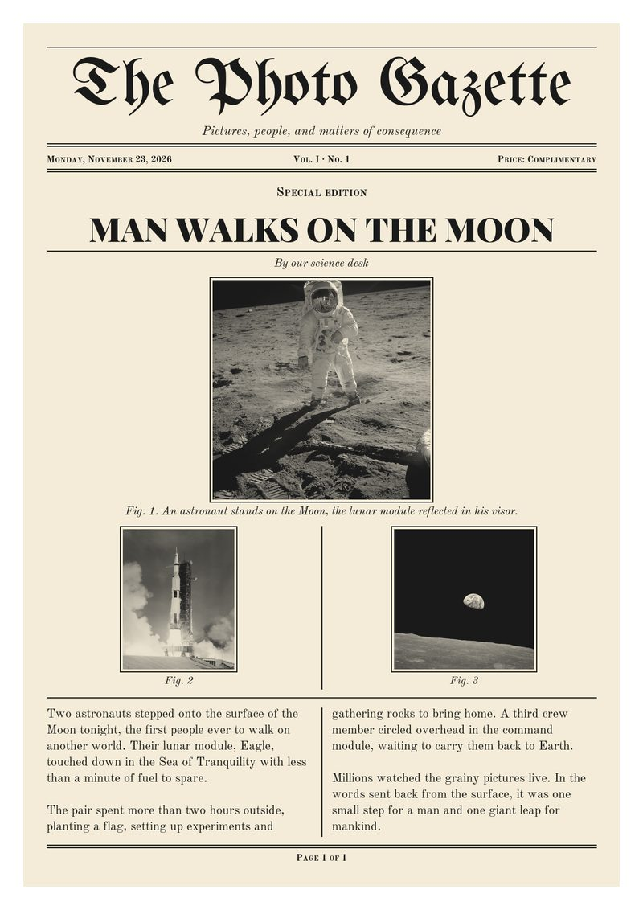<br><code>portrait</code></td><td align="center">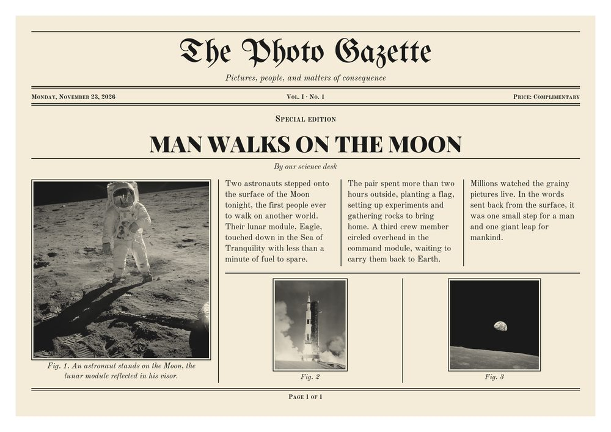<br><code>--landscape</code></td></tr></table>

Both samples: `prt gazette astronaut.jpg launch.jpg earthrise.jpg --story-file story.json -o gazette.png`, the second with `--landscape`.

- Give several photos to print them all. The first is the lead picture, and the front page also holds the next two as plates. Each further page holds up to six more in a ruled grid, numbered Fig. 4, Fig. 5 and so on. No photo is left out: 4 photos make 2 pages, 10 make 3.
- `--landscape` lays the pages out on A4 turned on its side: the lead photo stands beside the story, the two plates sit under the story, and further pages hold their six plates three abreast. Saved pages stay landscape; each page is turned upright only for the printer, so it prints sideways on the sheet.
- One run takes at most 57 photos (10 pages). More are refused with exit code 3 before any photo is read, written or printed, so print them in batches.
- The story works as in `prt booth`: `--story-file story.json`, or `--story-file -` for stdin (`headline` and `story` required; `kicker`, `caption` and `byline` optional), with `--headline`, `--story`, `--kicker`, `--caption` and `--byline` to override single fields. The caption goes under the lead photo. A story too long for the front page is set in smaller type, then cut with `…`, and the command warns. With `-f json` the output carries the same fit report as `prt booth` (`fits`, and `cut` with `max_fit` and `given` for each cut field).
- `--preview`/`-o` and `--save` work as in `prt article`: a `.pdf` holds every page, while `.png`, `.jpg` or `.jpeg` save one image per page (`page-1.png`, `page-2.png`, …). A file name that would overwrite one of the photos is refused with exit code 2.
- Every photo is read before anything is written or sent, so an unreadable or unsupported photo exits with code 3, names the file and prints nothing. Each page prints as its own job after one confirmation (`--yes` skips it). If a later page fails, the jobs already queued are named so you can cancel them with `prt jobs cancel`.
- The type is UnifrakturMaguntia, Playfair Display and Old Standard TT, which ship with printer-cli (see [License](#license)). Letters these fonts lack print without their accents, and other scripts and emoji are refused as in the photo booth.

**A letter as a gazette edition.** Scan and print work together: scan a handwritten letter as a JPEG, type it out as the story, and print the scan as the lead picture. The [letter-gazette skill](https://github.com/luongnv89/printer-cli/blob/main/skills/letter-gazette/SKILL.md) has an AI agent do the reading and writing (`prt skills install` installs it). With `-p demo` the scan is a sample letter, so the whole workflow runs without a printer:

```bash
prt -p demo scan --format jpeg -o letter.jpg                                          # scan the letter as a JPEG
prt -p demo gazette letter.jpg --story-file story.json --preview edition.pdf -f json   # the transcription as the story
prt -p demo gazette letter.jpg --story-file story.json --yes                           # print it
```

## Morning edition

`prt gazette --edition morning --edition-file morning.json` prints **The Morning Gazette**, a text-first front page with no photos: weather, today's calendar, to-dos and headlines in ruled vintage columns on one A4 page. `prt schema morning` gives the JSON file's shape; `--edition-file -` reads it from stdin. `--preview`/`-o` renders without printing, `--save` keeps a copy, and the `-f json` line has the usual `fits`, `cut` and ink `estimate`.

```bash
prt gazette --edition morning --edition-file morning.json --preview morning.pdf -f json
prt gazette --edition morning --edition-file morning.json --yes
```

prt deliberately does not run a scheduler. Run the same command from the operating system's scheduler; use `--yes` because there is no one to answer its prompt:

```bash
# cron, every morning at 07:30
30 7 * * * cd /path/to/morning && prt gazette --edition morning --edition-file morning.json --yes
# systemd: put the same prt command in the ExecStart of a service started by a timer
# launchd: put it in ProgramArguments of a LaunchAgent with a StartCalendarInterval
```

An agent can gather the weather, calendar events, tasks and headlines itself, write the small JSON file, preview it, shorten anything `cut` names, and then print it. The file is at most 32 KiB; text in scripts the bundled fonts cannot print is refused, as for the other input files.

## Commit receipt

`prt receipt` prints **The Commit Receipt**, a one-page gazette of a repository's git log. `--period day` (the default) covers commits since local midnight; `--period week` covers the last seven days. The repository defaults to the current folder. Commits are grouped by day with their time, short hash, author and subject. `--preview`/`-o` renders without printing, `--save` keeps a copy, and the `-f json` line reports `repository`, `period`, `commits`, `shown`, `fits`, `cut` and the ink `estimate`.

```bash
prt receipt --preview receipt.pdf -f json          # today's commits, nothing printed
prt receipt ~/src/project --period week --yes      # print the week
```

The repository is read only through fixed `git -C REPO log`/`rev-list` argument vectors, never through a shell. A path outside a git work tree exits with code 3; a repository or period with no commits prints an empty receipt. At most the newest 80 commits are laid out, and the summary says when more exist.

## Compose a page

`prt compose page.json` prints a page you describe as a list of blocks, for printables no other command makes: a flyer, a sign, a label sheet, a Wi-Fi card. The blocks are laid out top to bottom on A4 and run on to more pages when one is full.

```json
{
  "title": "Garden party",
  "blocks": [
    {"type": "heading", "text": "Garden Party", "align": "center"},
    {"type": "image", "path": "garden.jpg", "height": 80, "caption": "Last year"},
    {"type": "text", "text": "Saturday from 3 pm, at number 12.\nBring something to share.", "size": "large"},
    {"type": "rule"},
    {"type": "columns", "columns": [
      [{"type": "heading", "text": "Menu", "level": 2}, {"type": "text", "text": "Lemonade\nStrawberry cake"}],
      [{"type": "qr", "data": "https://example.com/rsvp", "size": 35, "caption": "Reply here"}]
    ]}
  ]
}
```

```bash
prt compose party.json --preview party.pdf   # render only, nothing printed
prt compose party.json --save party.pdf      # keep a copy and print
cat party.json | prt compose - --yes         # read the page from stdin
prt schema page                              # the page file's JSON Schema
```

| Block | Fields |
|---|---|
| `heading` | `text` (required), `level` 1 (largest, the default), 2 or 3, `align` |
| `text` | `text` (required; a newline starts a new paragraph), `size` `small`, `normal` or `large`, `align` |
| `image` | `path` (required), `height` in mm (at most), `caption`, `align` (default `center`) |
| `qr` | `data` (required, up to 500 characters), `size` in mm (15 to 150, default 40), `caption`, `align` (default `center`) |
| `columns` | `columns`: 2 to 4 lists of blocks side by side (any block but `columns`) |
| `rule` | `weight` `thin` (the default) or `thick` |

`align` is `left`, `center` or `right`. `title` names the print job and is not printed; it defaults to the first heading.

- The page file is checked against `prt schema page` before anything is drawn, written or sent: an unknown block type or field, a missing field or a value out of range exits with code 3 and says where, e.g. `page.json: blocks[2].level must be one of 1, 2, 3, not 4`. Nothing is printed.
- Images are read from local files only (JPEG, PNG, WebP, GIF, BMP or TIFF): a relative path is read from the page file's folder (the current folder for `prt compose -`), a web link is refused and nothing is downloaded. Each image may be at most 30 MiB and 50 megapixels, and a page file may use 20 images. An image that is missing or cannot be read exits with code 3.
- Text runs on to the next page between lines, a heading moves to the next page rather than end one, and any other block moves whole. A heading or a `columns` block must fit on one page. A page file that needs more than 10 pages, a heading taller than a page, and a page file with nothing to print (only empty columns, or text the page font prints as nothing, such as a lone accent mark) are refused with exit code 3, so nothing is cut off and no blank sheet is sent.
- `--preview`/`-o` and `--save` work as in `prt article`: a `.pdf` holds every page, while `.png`, `.jpg` or `.jpeg` save one image per page (`page-1.png`, `page-2.png`, …). A name that would overwrite the page file or one of its images is refused with exit code 2. With `-f json` the output carries the `estimate` like the other page commands.
- The text font covers Latin letters, as in the photo booth: accents print without their marks, and emoji or other scripts are refused. A QR code may hold any text.

## Keep-alive patch

An inkjet that sits unused for a week or two can dry ink in its nozzles and clog them. `prt keepalive` prints a small patch on one A4 sheet: squares of solid cyan, magenta, yellow and black, then red, green and blue, then light cyan, light magenta, light grey and mid grey. Cyan, magenta, yellow and black always print; whether the tints and greys use a printer's light, grey or photo inks is up to its driver's colour management. Like the nozzle check it asks for confirmation first (`--yes` skips it) and refuses an offline or busy printer, exit `1`, kind `refused`. `--preview`/`-o` saves the page without printing, `--save` keeps a copy, and the page counts as one page against the [page caps](#agent-guardrails).

prt does not run a scheduler. Run it every few days from the operating system's scheduler, with `--yes` because there is no one to answer its prompt:

```bash
# cron, at 10:00 on every third day of the month (1st, 4th, 7th, …): keep the nozzles wet
0 10 */3 * * prt keepalive --yes
# systemd: put the same prt command in the ExecStart of a service started by a timer with OnCalendar=*-*-1/3 10:00
# launchd: put it in ProgramArguments of a LaunchAgent with a StartInterval of 259200 (three days)
```

## Safety

- **Head cleaning is refused** while any ink is at or below its low level, or while the waste ink pad is flagged. Cleaning flushes ink into the pad, and a full pad locks the printer until it's serviced. `--force` overrides this, and the TUI offers "Clean anyway".
- Nozzle check, cleaning, the test page, the keep-alive patch, the photo booth, greeting cards, the 4×6 prints and postcards, disc labels, bingo cards, puzzles, article printing, the gazette, commit receipts and composed pages ask for confirmation first. In scripts, pass `--yes`.
- printer-cli never resets the waste ink counter or writes to the printer's EEPROM.

### Agent guardrails

Before you let an AI agent print unattended, set `PRT_AGENT=1` in its environment and, if you like, page caps in the config file:

- **Agent mode** (`PRT_AGENT=1`, also `true`, `yes` or `on`): every command that prints or uses ink — `print`, `booth`, `card`, `comic`, `strip`, `instant`, `colour-in`, `postcard`, `disc`, `article`, `recipe`, `bingo`, `puzzle`, `gazette`, `compose`, `keepalive`, `maintain test-page`, `maintain nozzle-check`, `maintain clean` — refuses to run without `--yes`, even at a terminal, so an agent never sits waiting on a prompt and never prints without deciding to. The refusal exits `2` with kind `agent_confirmation_required`. `--preview` needs no `--yes`: it prints nothing.
- **Per-run cap**: `max_pages_per_run` in the config limits the pages one command may print (copies count). In agent mode it defaults to 10 when not set.
- **Daily cap**: `max_pages_per_day` in the config limits the pages printed per calendar day, counted across every command in `~/.cache/prt/pages.json`. A page counts once its job has been sent, even if sending failed, because the printer may have taken it.
- A print over a cap is refused whole, before the prompt and before anything is sent (exit `1`, kind `page_cap_exceeded` or `daily_page_cap_exceeded`). Configured caps apply outside agent mode too, and in the TUI. While a cap is in force, a file whose pages cannot be counted (plain text, PWG raster, office files) is refused with `page_count_unknown`; images count as one page and PDF pages are counted from the file.
- **Cost estimate**: with `-f json`, `prt booth`, `prt card`, `prt strip`, `prt instant`, `prt colour-in`, `prt postcard`, `prt disc`, `prt article`, `prt recipe`, `prt bingo`, `prt puzzle`, `prt gazette` and `prt compose` (preview or print) add an `estimate` of the rendered pages: the page count, whether they use colour, and for each ink the share of a standard cartridge they would use, e.g. `"estimate": {"pages": 3, "colour": true, "ink": {"cyan": 1.2, "magenta": 1.0, "yellow": 1.1, "black": 3.8}, "ink_percent": 3.8, "summary": "~3 pages, colour, est. ink 4%"}`. `ink_percent` is the cartridge that would run out first. The ink figures are rough: they assume a cartridge prints about 300 A4 pages at 5% coverage, and a smaller sheet (4×6, a disc) counts by its area, its summary naming the size (`"~1 page (4×6), …"`); on a disc the white hub and corners use no ink, so only the printed ring counts.

These guardrails stop a cooperating agent from using up a cartridge by mistake. They are not a security boundary: a process that can change its own environment or config can get around them.

With the demo printer's low inks and nearly full pad, `prt -p demo maintain clean` refuses and exits with code 1:

```
✗ Cyan ink is at 1% (low level 15%) — cleaning may empty it; replace the cartridge first
✗ Magenta ink is at 1% (low level 15%) — cleaning may empty it; replace the cartridge first
✗ Yellow ink is at 12% (low level 15%) — cleaning may empty it; replace the cartridge first
✗ waste ink pad is almost full — each cleaning adds to it; the printer may lock up when it is full
✗ error: head cleaning refused for safety
hint: replace low cartridges first, or pass --force if you understand the risk
```

## MCP server

`prt mcp` runs printer-cli as an [MCP](https://modelcontextprotocol.io) server over stdio, so an agent in any MCP client (Claude Desktop, Claude Code, Cursor, …) can check the printer, look at a page before it is printed and print it, without running commands or knowing flags. The MCP SDK is an optional extra:

```bash
pipx install 'printer-cli[mcp]'        # or: uv tool install 'printer-cli[mcp]'
```

Without it, `prt mcp` exits with code 2 (kind `missing_dependency`) and says how to install it. Add the server to your client's config; `-p` picks the printer the tools use by default (try `demo` first):

```json
{"mcpServers": {"printer": {"command": "prt", "args": ["-p", "demo", "mcp"]}}}
```

| Tool | What it does |
|---|---|
| `status` | State, alerts, ink, paper and waste pad, as `prt status -f json` |
| `ink` | Ink levels, as `prt ink -f json` |
| `list_styles` | Every booth, card, comic, strip, instant, colour-in, postcard, disc, article, recipe, bingo, puzzle and gazette style with its fields and character limits, as `prt styles -f json` |
| `preview_booth` | Render a photo (a file path) as a booth page in `metro`, `daily`, `wizard`, `wanted`, `certificate`, `sports`, `missing` or `movie` style, with an optional `story` object (`headline`, `story`, `kicker`, `caption`, `byline`). Prints nothing |
| `preview_article` | Render an article as magazine pages from a `source` (link or file) or from `content` (the article JSON object, HTML or text). Prints nothing |
| `print_file` | Print what a preview rendered (`token`), or a file (`path`) with `confirm: true` |

The preview tools return the rendered page image in the tool result (scaled to 1200 pixels; an article shows its first `max_images` pages, 3 by default), together with the fit report (`fits`, `cut`), the ink `estimate` and a `token`. Passing that token to `print_file` prints exactly the previewed pages. A token works once and lasts 30 minutes; the last 8 previews keep theirs. `print_file` never prints by accident: without a token or `confirm: true` it refuses with kind `confirmation_required`, and an unknown, used or expired token is refused with `invalid_token`. Every print goes through the [agent guardrails](#agent-guardrails): the page caps hold, and in agent mode the token or `confirm` counts as `--yes`. Errors come back as tool errors whose text is the same `{"error": {...}}` object `-f json` prints. `source: "-"` is refused, since stdin carries the MCP protocol.

## Agent skills

Five [agent skills](https://github.com/luongnv89/printer-cli/tree/main/skills) come with prt: `photo-booth`, which looks at a photo, writes a story that fits it and prints it with `prt booth`; `greeting-card`, which writes a verse for a photo and the occasion and prints it as a folding card with `prt card`; `article-print`, which prints an article with `prt article` and fetches the text itself when the command cannot; and `letter-gazette`, which scans a handwritten letter with `prt scan`, transcribes it and prints it as a vintage newspaper edition with `prt gazette`; and `puzzle-check`, which prints a puzzle with `prt puzzle` and keeps its answers, then scans the filled-in sheet with `prt scan` and checks what was written against them. `prt skills install` copies them where agents look for skills:

```bash
prt skills list                          # the bundled skills (-f json for name, version, description, files)
prt skills install --claude              # Claude Code: ~/.claude/skills/<skill>/SKILL.md (the default)
prt skills install --agents              # agents that read ~/.agents/skills, such as Codex
prt skills install --claude --project    # this project only: ./.claude/skills (or ./.agents/skills)
prt skills install photo-booth --dir ~/my-agent/skills   # one skill, into any skills folder
```

Name skills to install only those; the default is all of them. Installing again leaves skills that match the bundled ones alone. An installed file that differs from the bundled one, because you edited it or it came from another prt version, is never replaced: the command lists the files, installs nothing, and exits with code 1 (kind `skill_exists`). After upgrading prt, run `prt skills install --force` to replace the old skills with the new ones; this also replaces any edits you made to them. Files in a skill folder that prt does not ship are always left alone. With `-f json` the output is `{"action": "skills_install", "skills": [{"name": "photo-booth", "target": "claude", "path": "...", "status": "installed"}]}`, where `status` is `installed`, `updated`, `unchanged` or `replaced`.

**Claude Code plugin.** The repository is also a Claude Code plugin with the five skills and the [MCP server](#mcp-server):

```text
/plugin install printer-cli --marketplace luongnv89/printer-cli
```

On Claude Code older than 2.1.275, add the marketplace first: `/plugin marketplace add luongnv89/printer-cli`, then `/plugin install printer-cli@printer-cli`. The plugin starts `prt mcp` with `PRT_AGENT=1` (see [Agent guardrails](#agent-guardrails)), so install printer-cli with the `mcp` extra first: `uv tool install 'printer-cli[mcp]'`. The skills call `prt` too.

For agents reading the repository, [`AGENTS.md`](https://github.com/luongnv89/printer-cli/blob/main/AGENTS.md) sums up how to use prt from an agent and how to work on the code, and [`llms.txt`](https://github.com/luongnv89/printer-cli/blob/main/llms.txt) indexes the docs.

## How it talks to printers

| Feature | Protocol | Notes |
|---|---|---|
| Status, ink, info, jobs, identify | IPP (631) | Small IPP codec built in, no `ipptool` needed |
| Printing | IPP Print-Job | JPEG/PWG/URF go direct; PNG etc. are converted to JPEG; **PDF and other files go through the local CUPS queue** for the same printer, matched by UUID (the XP-6000 doesn't accept PDF) |
| Scanning | eSCL / AirScan (443) | Certificate checks are skipped for the scanner host only, because printers ship self-signed certificates |
| Page counter | SNMP v1 | Printer-MIB lifetime count |
| Nozzle check, cleaning | ESC/P2 remote mode on 9100 | Byte sequences from gutenprint's `escputil` (Epson only) |

When the printer is asleep, `status` and the TUI show the **last known status** from `~/.cache/prt/`, marked as cached.

## Configuration

`~/.config/prt/config.toml`. Override the location with `PRT_CONFIG` or `--config`. Priority order: **command-line flags > environment variables (`PRT_PRINTER`, `PRT_TIMEOUT`) > config file > defaults**.

```toml
default = "office"

[printers.office]
host = "EPSON721655.local"

[printers.pantum]
host = "192.168.1.80"
driver = "ipp"
```

`max_pages_per_run = 20` and `max_pages_per_day = 50`, at the top of the file, cap how many pages a print may use (see [Agent guardrails](#agent-guardrails)). Each must be a whole number of 1 or more; leave it out for no limit. `PRT_AGENT=1` turns on agent mode.

## Install options

With pipx:

```bash
pipx install printer-cli
```

From source (add `--editable` to track local changes):

```bash
git clone https://github.com/luongnv89/printer-cli.git && cd printer-cli
uv tool install .
```

With the MCP server (`prt mcp`), add the `mcp` extra: `pipx install 'printer-cli[mcp]'`.

Optional tab completion for your shell:

```bash
prt --install-completion
```

## Adding a printer brand

Drivers live in `src/prt/drivers/`:
- `IPPDriver` covers any IPP Everywhere / AirPrint printer.
- `EpsonDriver` adds maintenance and counters on top of it.
- `FakeDriver` replays a captured fixture, for tests and the demo.

To add a vendor, subclass `IPPDriver`, declare its `capabilities`, override what it can do, and register it in `drivers/registry.py`. The CLI and TUI hide actions a driver doesn't support.

## Development

```bash
uv sync
uv run pytest            # no printer needed
uv run prt -p demo tui
```

The `site/` folder holds the examples site: a static slideshow of every example in this README, each with its `prt` command and a prompt for an AI agent. It has no build step and loads nothing from elsewhere, so opening `site/index.html` in a browser, or serving the folder as it is, shows it. `tests/test_site.py` keeps its slides in step with this README.

## Troubleshooting

- **"cannot reach printer"**: the printer is probably asleep. Press any button on it, or check `prt discover`.
- **Shell completion isn't detected**: write the script out manually, e.g. `_PRT_COMPLETE=source_zsh prt > ~/.zfunc/_prt`.
- **PDF won't print**: add the printer in System Settings → Printers so a CUPS queue exists, or print a JPEG.

## License

[MIT](https://github.com/luongnv89/printer-cli/blob/main/LICENSE) © Luong NGUYEN

The fonts used by `prt gazette`, [UnifrakturMaguntia](https://github.com/google/fonts/tree/main/ofl/unifrakturmaguntia), [Playfair Display](https://github.com/google/fonts/tree/main/ofl/playfairdisplay) and [Old Standard TT](https://github.com/google/fonts/tree/main/ofl/oldstandardtt), and the handwriting font used by `prt strip`, `prt instant`, `prt postcard`, `prt disc` and `prt recipe`, [Caveat](https://github.com/google/fonts/tree/main/ofl/caveat), are under the SIL Open Font License 1.1. Their licence texts ship with them in [`src/prt/fonts`](https://github.com/luongnv89/printer-cli/tree/main/src/prt/fonts) as `OFL-*.txt`.

The photos in the sample pages ([`assets/samples`](https://github.com/luongnv89/printer-cli/tree/main/assets/samples)) are public-domain NASA images from Apollo 8, Apollo 11 and Apollo 17, via Wikimedia Commons.
